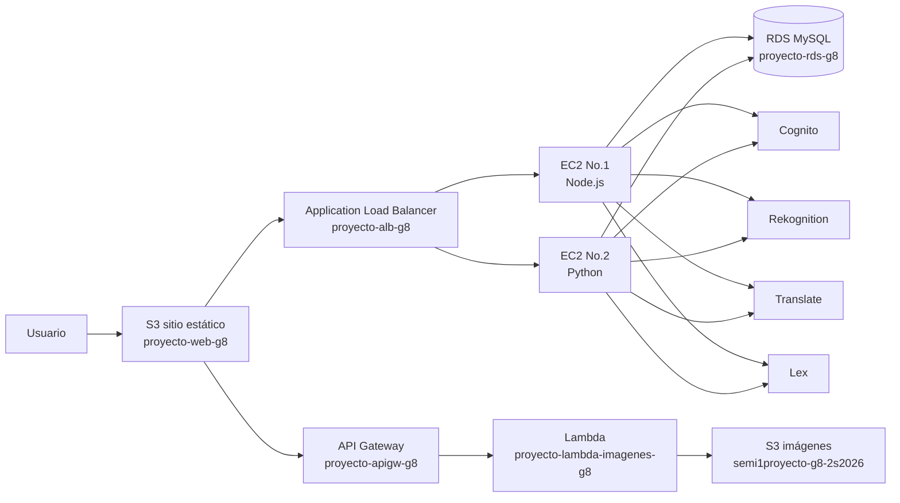
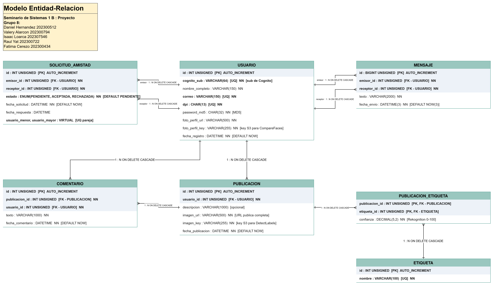
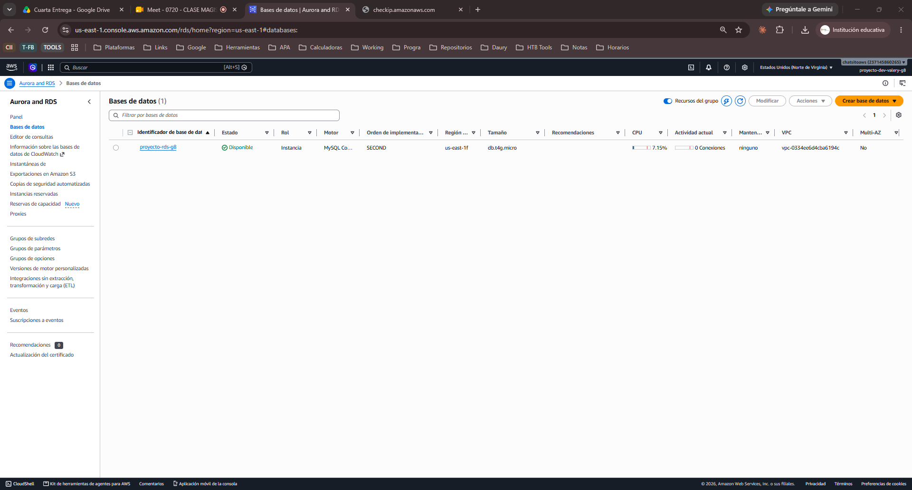
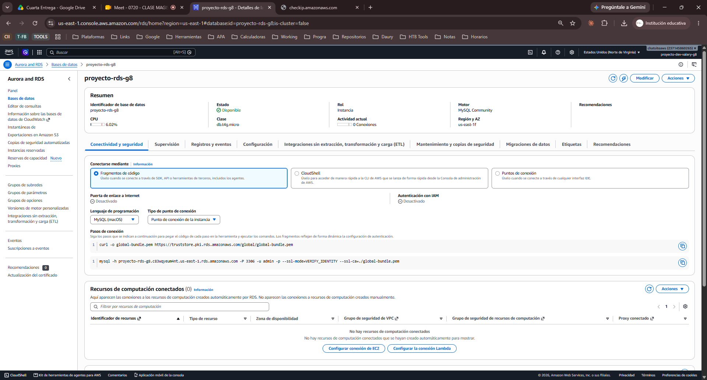

# Manual técnico — Proyecto "Semi-Social"

**Curso:** Seminario de Sistemas 1 · Sección B · **Grupo 8**

## Índice

1. [Datos de los estudiantes](#1-datos-de-los-estudiantes)
2. [Descripción](#2-descripción)
3. [Arquitectura](#3-arquitectura)
4. [Dominios](#4-dominios)
5. [Usuarios IAM, permisos y roles](#5-usuarios-iam-permisos-y-roles)
6. [Capturas de pantalla](#6-capturas-de-pantalla)
7. [Estructura del repositorio](#7-estructura-del-repositorio)
8. [Decisiones frente al enunciado](#8-decisiones-frente-al-enunciado)

| Lo que pide el enunciado para el manual | Dónde está |
|---|---|
| Datos de los estudiantes | [§1](#1-datos-de-los-estudiantes) |
| Descripción de la arquitectura | [§3](#3-arquitectura) |
| Usuarios IAM, permisos y roles | [§5](#5-usuarios-iam-permisos-y-roles) |
| Capturas: buckets de S3 | [§6.1](#61-buckets-de-s3) |
| Capturas: EC2 | [§6.2](#62-ec2) |
| Capturas: base de datos RDS | [§6.3](#63-base-de-datos-rds) |
| Capturas: aplicación web | [§6.4](#64-aplicación-web) |
| Capturas: funciones Lambda | [§6.5](#65-funciones-lambda) |
| Capturas: pool de Cognito | [§6.6](#66-pool-de-cognito) |
| Capturas: configuración de Amazon Lex | [§6.7](#67-configuración-de-amazon-lex) |
| Capturas: check del Load Balancer | [§6.8](#68-check-del-load-balancer) |

---

## 1. Datos de los estudiantes

| Integrante | Carné | Dominios a cargo |
|---|---|---|
| Daniel Hernández | 202300512 | Plataforma, imágenes |
| Valery Alarcón | 202300794 | Datos, publicaciones |
| Isaac Loarca | 202307546 | Identidad · base de `backend-node` |
| Raúl Yat | 202300722 | Amistades, chat, chatbot · base de `backend-python` |
| Fátima Cerezo | 202300434 | Perfil, comentarios, traducción · base de `frontend` |

## 2. Descripción

Semi-Social es una red social desplegada por completo en AWS. Los usuarios se registran y verifican
su correo con Cognito, inician sesión con contraseña o con su rostro (Rekognition), publican imágenes
que se etiquetan solas, filtran el feed por esas etiquetas, comentan, traducen contenido, agregan
amigos, chatean en tiempo real y consultan un chatbot de Lex sobre la Facultad de Ingeniería.

## 3. Arquitectura



El frontend se carga desde S3 y consume el backend por el DNS del ALB. Las imágenes van por una ruta
aparte: API Gateway, luego Lambda y luego S3. Los dos backends exponen el mismo contrato, así que da
igual a cuál de las dos EC2 envíe el ALB cada petición.

### 3.1 Modelo entidad-relación

Una sola base de datos en Amazon RDS (`semisocial`, MySQL 8.4) atiende a los dos backends. Las reglas
de diseño de cada tabla están en [datos §4](dominios/datos/README.md#4-datos-en-rds) y el script en
[`database/schema.sql`](database/schema.sql).



## 4. Dominios

Cada dominio documenta en su carpeta los servicios, el contrato de API, los datos, la configuración
en AWS, las capturas y las preguntas que el grupo debe saber responder.

| Dominio | Qué resuelve | Servicios de AWS |
|---|---|---|
| [Plataforma](dominios/plataforma/README.md) | IAM, security groups, EC2, ALB y hosting web | IAM, VPC, EC2, ELB, S3 |
| [Datos](dominios/datos/README.md) | Esquema relacional y contraseñas en MD5 | RDS |
| [Identidad](dominios/identidad/README.md) | Registro, verificación por correo, login y login facial | Cognito, Rekognition, Lambda |
| [Perfil](dominios/perfil/README.md) | Edición de nombre, DPI y foto, sincronizada con Cognito | Cognito, S3 |
| [Imágenes](dominios/imagenes/README.md) | Carga de imágenes a `Fotos_Perfil` y `Fotos_Publicadas` | API Gateway, Lambda, S3 |
| [Publicaciones](dominios/publicaciones/README.md) | Feed, etiquetas automáticas y filtros | Rekognition, RDS |
| [Comentarios](dominios/comentarios/README.md) | Comentarios entre amigos | RDS |
| [Traducción](dominios/traduccion/README.md) | Traducción de descripciones y comentarios | Translate |
| [Amistades](dominios/amistades/README.md) | Usuarios y solicitudes de amistad | RDS |
| [Chat](dominios/chat/README.md) | Mensajería en tiempo real por WebSocket | ELB, RDS |
| [Chatbot](dominios/chatbot/README.md) | Bot con información de la facultad | Lex, Lambda |

## 5. Usuarios IAM, permisos y roles

Cuenta `237145860265`, región `us-east-1`. Cada servicio tiene su propia identidad con una política
administrada limitada a lo que ese servicio necesita. El detalle y el porqué de cada permiso está en
[plataforma §7.2–7.4](dominios/plataforma/README.md), y el JSON de cada política en
[`infra/iam/`](infra/iam/).

**Usuarios por servicio** (solo acceso programático):

| Usuario | Política | Qué permite |
|---|---|---|
| `proyecto-iam-s3-g8` | `proyecto-s3-policy-g8` | Listar, leer, escribir y borrar objetos de los dos buckets |
| `proyecto-iam-ec2-g8` | `proyecto-ec2-policy-g8` | `ec2:*` y `elasticloadbalancing:*` en `us-east-1`; `iam:PassRole` solo de `proyecto-ec2-role-g8` |
| `proyecto-iam-rds-g8` | `proyecto-rds-policy-g8` | `rds:*` en `us-east-1` y lectura de VPC, subredes y security groups |
| `proyecto-iam-cognito-g8` | `proyecto-cognito-policy-g8` | Acciones `Admin*`, `ListUsers` y `Describe*` sobre los *user pools* |
| `proyecto-iam-rekognition-g8` | `proyecto-rekognition-policy-g8` | `DetectLabels`, `CompareFaces`, `DetectFaces` y leer las dos carpetas de imágenes |
| `proyecto-iam-translate-g8` | `proyecto-translate-policy-g8` | `TranslateText` y `comprehend:DetectDominantLanguage` |
| `proyecto-iam-lex-g8` | `proyecto-lex-policy-g8` | `RecognizeText` y sesiones sobre los alias de los bots |

**Roles**:

| Rol | Lo asume | Para qué |
|---|---|---|
| `proyecto-ec2-role-g8` | Las dos EC2 (perfil de instancia) | Llamar a Cognito, Rekognition, Translate y Lex con credenciales temporales. Reutiliza las políticas de los usuarios de esos servicios |
| `proyecto-lambda-role-g8` | La Lambda de imágenes | `s3:PutObject` solo en `Fotos_Perfil/*` y `Fotos_Publicadas/*`, y escribir sus logs |

**Usuarios del equipo:** `proyecto-dev-<nombre>-g8`, en el grupo `proyecto-equipo-g8`, solo con acceso
a la consola. Sirven para que cada integrante configure su dominio (Cognito, Lex, RDS…); la aplicación
nunca los usa.

## 6. Evidencias

### 6.1 Buckets de S3

- [ ] `dominios/imagenes/img/s3-imagenes.png`: bucket `semi1proyecto-g8-2s2026` con `Fotos_Perfil/` y `Fotos_Publicadas/` · **Daniel**
- [ ] `dominios/imagenes/img/s3-politica.png`: *bucket policy* de lectura pública · **Daniel**
- [ ] `dominios/plataforma/img/s3-hosting.png`: `proyecto-web-g8` con *Static website hosting* y su endpoint · **Daniel**

### 6.2 EC2

- [ ] `dominios/plataforma/img/ec2-instancias.png`: las dos instancias `running` · **Daniel**
- [ ] `dominios/plataforma/img/sg-reglas.png`: reglas de entrada de los tres security groups · **Daniel**

### 6.3 Base de datos RDS

Instancia `proyecto-rds-g8` disponible: MySQL 8.4.11, `db.t4g.micro`, una sola zona.



Motor, clase, zona y endpoint de la instancia:



- [ ] `dominios/datos/img/rds-conectividad.png`: security group `proyecto-rds-sg-g8` y acceso público = No (domingo 25) · **Valery**
- [ ] `dominios/datos/img/rds-tablas.png`: `SHOW TABLES;` y un usuario con su `password_md5`, desde una EC2 · **Valery**
- [ ] `dominios/publicaciones/img/etiquetas-rds.png`: etiquetas de Rekognition guardadas de una publicación · **Valery**

### 6.4 Aplicación web

- [ ] `dominios/identidad/img/app-login-facial.png`: login facial exitoso · **Isaac**
- [ ] `dominios/publicaciones/img/feed.png`: feed con publicaciones propias y de amigos · **Valery**
- [ ] `dominios/publicaciones/img/filtros.png`: filtros por etiqueta, *Todos* y el buscador · **Valery**
- [ ] `dominios/comentarios/img/comentarios-app.png`: publicación con comentarios de amigos · **Fátima**
- [ ] `dominios/traduccion/img/traduccion-app.png`: descripción y comentario traducidos · **Fátima**
- [ ] `dominios/perfil/img/perfil-app.png`: edición de perfil · **Fátima**
- [ ] `dominios/amistades/img/amistades-usuarios.png`: usuarios que no son amigos · **Raúl**
- [ ] `dominios/amistades/img/amistades-solicitudes.png`: solicitudes pendientes · **Raúl**
- [ ] `dominios/chat/img/chat-dos-usuarios.png`: conversación entre dos usuarios · **Raúl**
- [ ] `dominios/chatbot/img/lex-app.png`: botón del chatbot y una conversación · **Raúl**

### 6.5 Funciones Lambda

- [ ] `dominios/imagenes/img/lambda-funcion.png`: `proyecto-lambda-imagenes-g8` con su trigger de API Gateway · **Daniel**
- [ ] `dominios/imagenes/img/lambda-logs.png`: registro de una carga exitosa en CloudWatch · **Daniel**
- [ ] `dominios/imagenes/img/apigw-recurso.png`: recurso, método e integración con Lambda · **Daniel**
- [ ] `dominios/identidad/img/cognito-triggers.png`: triggers Lambda del flujo `CUSTOM_AUTH` · **Isaac**

### 6.6 Pool de Cognito

- [ ] `dominios/identidad/img/cognito-pool.png`: resumen del pool y atributos, incluido `custom:dpi` · **Isaac**
- [ ] `dominios/identidad/img/cognito-usuarios.png`: usuarios en estado `Confirmed` · **Isaac**
- [ ] `dominios/identidad/img/cognito-correo.png`: correo de verificación recibido · **Isaac**

### 6.7 Configuración de Amazon Lex

- [ ] `dominios/chatbot/img/lex-intents.png`: intenciones con sus *utterances* · **Raúl**
- [ ] `dominios/chatbot/img/lex-slots.png`: *slots* configurados · **Raúl**
- [ ] `dominios/chatbot/img/lex-alias.png`: alias y Lambda de *fulfillment* · **Raúl**

### 6.8 Check del Load Balancer

- [ ] `dominios/plataforma/img/alb-targets.png`: las dos instancias `healthy` en el target group · **Daniel**
- [ ] `dominios/plataforma/img/alb-prueba-caida.png`: una instancia detenida y la app respondiendo por el DNS del ALB · **Daniel**

## 7. Estructura del repositorio

```
Proyecto/
├── README.md              ← este manual
├── dominios/<dominio>/    ← documentación y capturas de cada dominio
├── backend-node/src/      ← EC2 No.1, una carpeta por dominio
├── backend-python/src/    ← EC2 No.2, una carpeta por dominio
├── frontend/src/          ← React, una carpeta por dominio
├── serverless/            ← Lambdas: imagenes, identidad (triggers de Cognito), chatbot
├── database/              ← schema.sql y seed.sql
├── infra/                 ← políticas IAM y script de arranque de las EC2
└── docs/                  ← enunciado y plan del equipo
```

El detalle de la organización, el reparto y el cronograma están en el
[plan del equipo](docs/plan/distribucion-equipo.md).

## 8. Decisiones frente al enunciado

| Enunciado | Implementado | Motivo |
|---|---|---|
| Bucket `Proyecto-Web-G#` | `proyecto-web-g8` | S3 no admite mayúsculas en el nombre de un bucket |
| Bucket `semi1proyecto-g#` | `semi1proyecto-g8-2s2026` | El espacio de nombres de S3 es global y `semi1proyecto-g8` ya lo tiene otra cuenta de AWS (`BucketAlreadyExists`). Se agregó el semestre |
| Las dos EC2 son "clones" | Dos backends equivalentes: Node.js en la No.1 y Python en la No.2 | La rúbrica evalúa cada EC2 con un lenguaje distinto. Ambas exponen el mismo contrato |
| Contraseñas en MD5 | MD5 en RDS; Cognito guarda la suya por separado | Lo exige la rúbrica, aunque MD5 no es seguro hoy en día |
