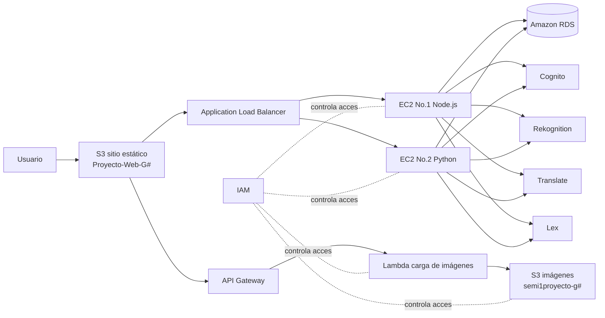
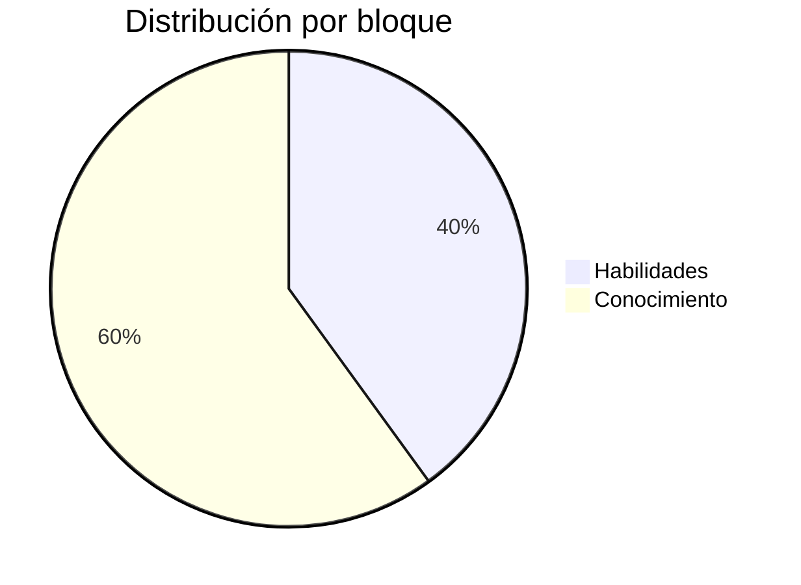
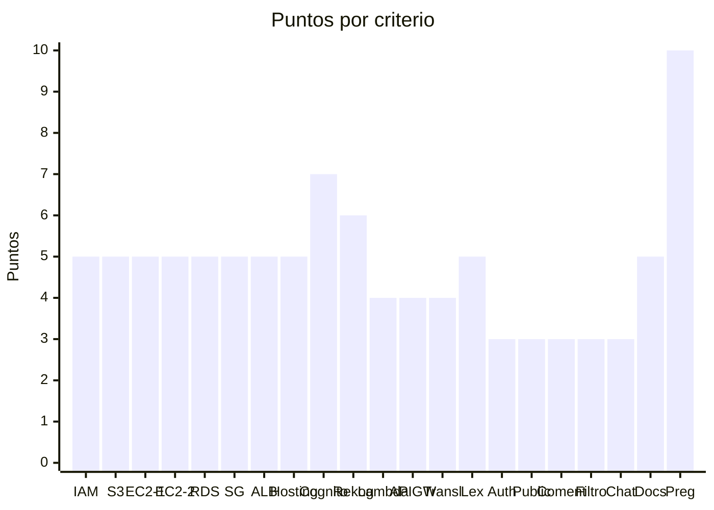
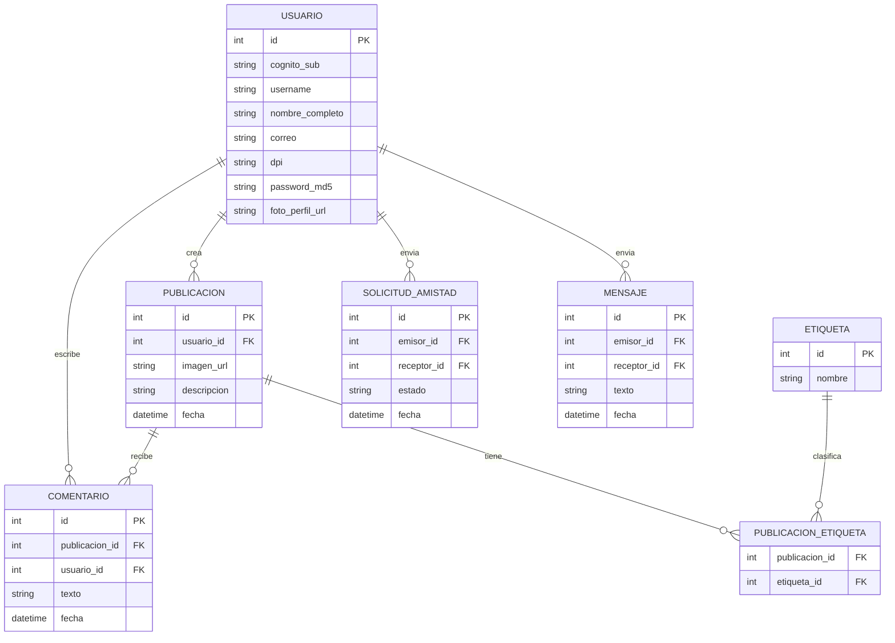

# Análisis del Proyecto Semi-Social

**Curso:** Seminario de Sistemas 1, Ingeniería en Ciencias y Sistemas, FIUSAC
**Ponderación:** 30 pts del curso
**Tiempo estimado:** 30 horas
**Calificación:** 27 de octubre de 2026

---

## 1. Resumen del proyecto

Semi-Social es una aplicación web tipo red social desplegada por completo en AWS. Los usuarios se registran, inician sesión con contraseña o con reconocimiento facial, publican imágenes, comentan, filtran publicaciones por etiquetas, traducen contenido, gestionan solicitudes de amistad, chatean en tiempo real con sus amigos y consultan un chatbot sobre la Facultad de Ingeniería.

El enunciado deja claro que **nada puede ejecutarse localmente**: frontend, backend, base de datos y almacenamiento deben vivir en la nube.

---

## 2. Servicios de AWS requeridos

| # | Servicio | Uso dentro del proyecto |
|---|----------|--------------------------|
| 1 | IAM | Usuarios, roles y políticas separados por servicio |
| 2 | EC2 | Dos instancias con el backend |
| 3 | ELB | Application Load Balancer que reparte tráfico entre las dos EC2 |
| 4 | RDS | Base de datos MySQL o PostgreSQL, sin bases locales ni en contenedores |
| 5 | S3 | Bucket de imágenes y bucket del sitio web estático |
| 6 | API Gateway | Endpoint obligatorio para subir imágenes |
| 7 | Lambda | Procesa la imagen recibida por API Gateway y la guarda en S3 |
| 8 | Cognito | Pool de usuarios, registro, login y verificación por correo |
| 9 | Rekognition | Etiquetas de imágenes y login facial |
| 10 | Translate | Traducción de descripciones y comentarios |
| 11 | Lex | Chatbot con información de la facultad |

---

## 3. Arquitectura

El flujo general consiste en que el usuario carga el frontend desde S3, el frontend consume el backend a través del DNS del balanceador y las imágenes viajan por una ruta separada: API Gateway, luego Lambda, luego S3.

---

## 4. Módulos funcionales

### 4.1 Registro
Campos obligatorios: nombre completo, correo, DPI, contraseña y confirmación de contraseña. La foto de perfil es obligatoria y puede subirse desde archivo o tomarse con la webcam, porque luego sirve para el login facial. Se implementa con Cognito y debe incluir verificación por correo.

### 4.2 Login
Dos vías: usuario y contraseña, o reconocimiento facial comparando contra la foto de perfil con Rekognition. Ambas deben pasar por Cognito.

### 4.3 Página principal
- **Feed:** publicaciones propias y de amigos, ordenadas de la más reciente a la más antigua.
- **Comentarios:** cada publicación recibe comentarios de amigos.
- **Filtros:** lista dinámica generada a partir de las etiquetas de Rekognition, con el filtro "Todos" siempre visible, más un buscador de etiquetas por texto.
- **Crear publicación:** imagen obligatoria y descripción opcional.
- **Traducir:** descripción y comentarios traducibles a tres idiomas además del español con Translate.

### 4.4 Edición de perfil
Permite modificar nombre, DPI y foto. Exige la contraseña correcta para guardar y los cambios deben reflejarse tanto en RDS como en Cognito.

### 4.5 Usuarios y amigos
Un apartado lista solo a los usuarios que todavía no son amigos. La amistad funciona con solicitudes que se aceptan o rechazan, al estilo de Facebook. Los amigos aparecen únicamente en el chat.

### 4.6 Chat
Mensajería en tiempo real entre amigos. Se recomienda WebSockets.

### 4.7 Chatbot Lex
Botón de acceso visible que abre un bot con horarios y preguntas frecuentes de la facultad. Integrar Lambda para respuestas dinámicas suma valor.

---

## 5. Requisitos de infraestructura

- **EC2 y ALB:** dos instancias detrás de un Application Load Balancer, con los mismos endpoints. Al detener una, la app debe seguir funcionando por el DNS del balanceador.
- **RDS:** contraseñas guardadas con MD5 según la rúbrica.
- **S3 de imágenes:** nombre `semi1proyecto-g#` con las carpetas `Fotos_Perfil` y `Fotos_Publicadas`, con acceso público de lectura funcional.
- **S3 del sitio:** hosting estático y conexión al balanceador.
- **Cognito:** el pool debe guardar como mínimo nombre, correo, DPI y contraseña. El DPI necesitará un atributo personalizado.
- **Seguridad:** security groups que solo abran los puertos necesarios y desde los orígenes autorizados. Por ejemplo, RDS aceptando conexiones únicamente desde el security group de las EC2.
- **IAM:** un usuario o rol por servicio con políticas específicas, como uno para S3 y otro para EC2.

---

## 6. Distribución de la nota

La rúbrica suma 100 puntos, repartidos 40 en Habilidades y 60 en Conocimiento.

### Habilidades, 40 pts

| No. | Criterio | Pts | Satisfactorio |
|-----|----------|-----|---------------|
| 1.1 | IAM | 5 | Usuarios y roles por servicio con separación de responsabilidades |
| 1.2 | S3 | 5 | Sitio en S3 y bucket de imágenes con `Fotos_Perfil` y `Fotos_Publicadas` públicas |
| 1.3 | EC2 No.1 | 5 | Backend en Node.js funcional |
| 1.4 | EC2 No.2 | 5 | Backend en Python funcional que responde al balanceador |
| 1.5 | RDS y lógica | 5 | Esquema relacional funcional y contraseñas en MD5 |
| 1.6 | Security groups | 5 | Solo puertos necesarios desde orígenes autorizados |
| 1.7 | Balanceador | 5 | La app sigue viva al apagar una instancia |
| 1.8 | Hosting web | 5 | Sitio estático conectado al backend vía ALB |

### Conocimiento, 60 pts

| No. | Criterio | Pts |
|-----|----------|-----|
| 2.1 | Cognito registro, login y verificación por correo | 7 |
| 2.2 | Rekognition etiquetas y login facial | 6 |
| 2.3 | Lambda procesamiento de imágenes | 4 |
| 2.4 | API Gateway carga de imágenes | 4 |
| 2.5 | Translate | 4 |
| 2.6 | Lex chatbot | 5 |
| 2.7 | Registro y login funcionales | 3 |
| 2.8 | Publicación de imágenes en S3 | 3 |
| 2.9 | Comentarios | 3 |
| 2.10 | Filtro por etiquetas | 3 |
| 2.11 | Chat en tiempo real | 3 |
| 2.12 | Documentación | 5 |
| 2.13 | Preguntas a todos los integrantes | 10 |

Lo que más pesa individualmente son las **preguntas de conocimiento**, seguidas de **Cognito** y **Rekognition**. Esos tres criterios juntos valen 23 puntos.

### Requisitos para optar a calificación
1. Backend en Python y JavaScript, frontend con React o Angular.
2. Todo desplegado en AWS.
3. Repositorio con código fuente y README.

---

## 7. Entregables

- Repositorio privado en GitHub llamado `SEMINARIO1_A_1S2026_G#`.
- Carpeta `Proyecto` con el código de backend y frontend.
- `README.md` como manual técnico con:
  - datos de los estudiantes
  - descripción y diagrama de la arquitectura
  - usuarios IAM, roles y políticas
  - capturas de buckets S3, EC2, RDS, aplicación web, funciones Lambda, pool de Cognito, configuración de Lex y prueba del balanceador
- Colaboradores: `elder1095`, `CarlosJezeh777` y `marckomatic`.

Durante la calificación **no se puede modificar código ni configuraciones**.

---

## 8. Inconsistencias y puntos a aclarar con el auxiliar

1. **Fechas contradictorias.** El objetivo SMART habla de marzo a abril de 2026, pero el cronograma fija la elaboración del 23 de septiembre al 28 de octubre y la calificación el 27 de octubre, un día antes de que termine la elaboración. La fecha que manda en la práctica es el **27 de octubre**.
2. **Instancias clones versus lenguajes distintos.** El enunciado pide que ambas EC2 sean clones, pero la rúbrica evalúa la No.1 con Node.js y la No.2 con Python. La lectura más segura es implementar **dos backends equivalentes**, uno en cada lenguaje, con los mismos endpoints y respuestas.
3. **Nombre del bucket web.** `Proyecto-Web-G#` lleva mayúsculas y S3 no las permite en nombres de bucket. Conviene usar `proyecto-web-g#` y explicarlo en el README.
4. **"Amazon Flex"** en la lista de capturas es un error de redacción, se refiere a Amazon Lex.
5. **Criterio 2.10.** La columna de "Necesita mejorar" habla de películas favoritas, texto heredado de otra práctica.
6. **Criterio 2.13.** Vale 10 puntos pero su rango aparece como 5 a 3 y 2 a 0, probablemente se duplica.
7. **MD5.** La rúbrica lo exige aunque no es un algoritmo seguro hoy en día. Hay que cumplirlo en RDS, y vale la pena saber justificarlo en las preguntas. Cognito maneja sus propias contraseñas de forma independiente.

---

## 9. Retos técnicos clave

- **Login facial con Cognito.** Cognito no compara rostros por sí solo. Un enfoque viable es usar `CompareFaces` de Rekognition contra la foto de perfil en S3 y, si coincide, autenticar mediante un flujo de autenticación personalizado de Cognito con triggers Lambda, o desde el backend con `AdminInitiateAuth`.
- **WebSockets detrás del ALB.** Con dos instancias, un mensaje puede llegar a una EC2 mientras el destinatario está conectado a la otra. Opciones: sticky sessions en el target group, o persistir los mensajes en RDS y hacer que cada instancia los reenvíe. También puede usarse API Gateway WebSocket.
- **Dos backends idénticos.** Definir primero un contrato de API, por ejemplo con OpenAPI, para que Node.js y Python respondan igual y el frontend no note la diferencia.
- **Sincronización RDS y Cognito.** Cada registro y cada edición de perfil debe escribir en ambos. La relación natural es guardar el `sub` de Cognito como columna en la tabla de usuarios.
- **Carga de imágenes por API Gateway.** API Gateway tiene un límite de 10 MB por payload, así que hay que validar o comprimir en el frontend. Tras subir, se llama a `DetectLabels` y las etiquetas se guardan en RDS.

---

## 10. Modelo de datos sugerido

La amistad se obtiene de las solicitudes con estado aceptada, así que no hace falta una tabla aparte.

---

## 11. Plan de trabajo sugerido

Quedan pocos días antes de la calificación, así que conviene priorizar por puntos y por dependencias.

| Orden | Bloque | Por qué primero |
|-------|--------|-----------------|
| 1 | IAM, VPC, security groups, RDS y buckets S3 | Todo lo demás depende de esto |
| 2 | API Gateway y Lambda de imágenes | Lo necesitan registro y publicaciones |
| 3 | Cognito registro y login con verificación | 10 pts entre 2.1 y 2.7 |
| 4 | Backends Node.js y Python con el mismo contrato | 10 pts de EC2 más el resto de módulos |
| 5 | ALB y prueba de apagar una instancia | 5 pts y requisito de alta disponibilidad |
| 6 | Publicaciones, Rekognition, filtros y comentarios | 15 pts acumulados |
| 7 | Login facial | Completa el criterio de Rekognition |
| 8 | Translate, amigos y chat | 7 pts más funcionalidad visible |
| 9 | Lex con botón en el frontend | 5 pts, se puede hacer en paralelo |
| 10 | README con capturas y ensayo de preguntas | 15 pts entre documentación y preguntas |

Recomendación final: asegurarse de que **cada integrante pueda explicar toda la arquitectura**, no solo su parte, porque las preguntas valen 10 puntos y la rúbrica penaliza si solo una parte del grupo responde bien.
