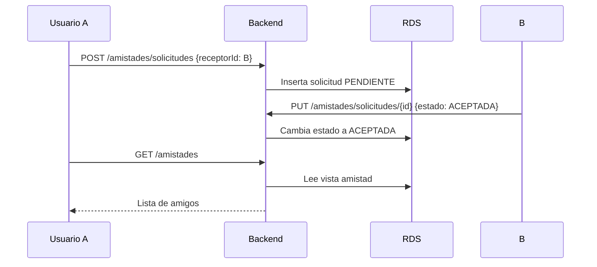

# Amistades — usuarios y solicitudes

> **Responsable:** R4 · Raúl Yat (202300722)  
> **Rúbrica:** Base de 2.9, 2.10 y 2.11 (feed, comentarios y chat dependen de las amistades)  
> **Fase:** Fase 1  
> Volver al [manual técnico](../../README.md) · [Plan del equipo](../../docs/plan/distribucion-equipo.md)

## 1. Qué resuelve

- Listar solo a los usuarios que todavía no son amigos.
- Enviar, aceptar y rechazar solicitudes de amistad.
- Lista de amigos, que se muestra solo en el chat.

## 2. Servicios de AWS

| Servicio | Recurso | Para qué |
|---|---|---|
| RDS | Tabla `solicitud_amistad` | Solicitudes y amistades |

## 3. Contrato de API

Node.js y Python deben responder **exactamente igual**: mismas rutas, mismos códigos HTTP y el
mismo JSON. Cualquier cambio se acuerda aquí antes de programarlo.

| Método | Ruta | Auth | Cuerpo | Respuesta |
|---|---|---|---|---|
| GET | `/amistades/personas` | Bearer | — | `200 {"usuarios":[{"id","nombreCompleto","fotoPerfilUrl"}]}` |
| GET | `/amistades/solicitudes` | Bearer | — | `200 {"recibidas":[...],"enviadas":[...]}` |
| POST | `/amistades/solicitudes` | Bearer | `{"receptorId":2}` | `201 {"solicitud":{"id":1,"fechaSolicitud":"...","usuario":{...}}}` |
| PUT | `/amistades/solicitudes/{id}` | Bearer | `{"estado":"ACEPTADA"}` o `{"estado":"RECHAZADA"}` | `200 {"mensaje":"Solicitud actualizada"}` |
| GET | `/amistades` | Bearer | — | `200 {"amigos":[{"id","nombreCompleto","fotoPerfilUrl"}]}` |

Las rutas que cambian datos requieren un usuario autenticado. Se responde `400` por entrada inválida,
`401` sin sesión, `404` si la solicitud no está pendiente para el usuario y `409` si la pareja ya
tiene solicitud pendiente o ya es amiga. Para una nueva solicitud después de un rechazo se reutiliza
la fila existente y vuelve a `PENDIENTE`.

## 4. Datos en RDS

`solicitud_amistad`, `usuario`.

## 5. Flujo

<!-- Diagrama de secuencia en mermaid del caso principal: quién llama a quién y con qué. -->

## 6. Dónde está el código

| Pieza | Carpeta |
|---|---|
| Backend Node.js (EC2 No.1) | [`backend-node/src/amistades/`](../../backend-node/src/amistades/) |
| Backend Python (EC2 No.2) | [`backend-python/src/amistades/`](../../backend-python/src/amistades/) |
| Frontend React | [`frontend/src/amistades/`](../../frontend/src/amistades/) |

## 7. Configuración en AWS

<!-- Paso a paso para reproducir lo configurado: nombre de cada recurso, opciones elegidas y por qué. -->

No se crean recursos AWS propios para este dominio. La tabla `solicitud_amistad` y la vista `amistad`
se crean con `database/schema.sql` en `proyecto-rds-g8`. La clave única por pareja evita solicitudes
duplicadas incluso si dos EC2 reciben solicitudes simultáneas.

## 8. Evidencias

Guardar cada captura en [`img/`](img/) con el nombre indicado y enlazarla en esta tabla.

| Archivo | Dónde se toma | Qué debe verse |
|---|---|---|
| `amistades-usuarios.png` | Aplicación | La lista de usuarios que no son amigos |
| `amistades-solicitudes.png` | Aplicación | Solicitudes pendientes con aceptar y rechazar |

## 9. Preguntas que todo el grupo debe poder responder

1. ¿Qué estados puede tener una solicitud y cómo se obtiene la lista de amigos?
2. ¿Qué pasa si A y B se envían solicitud al mismo tiempo?
