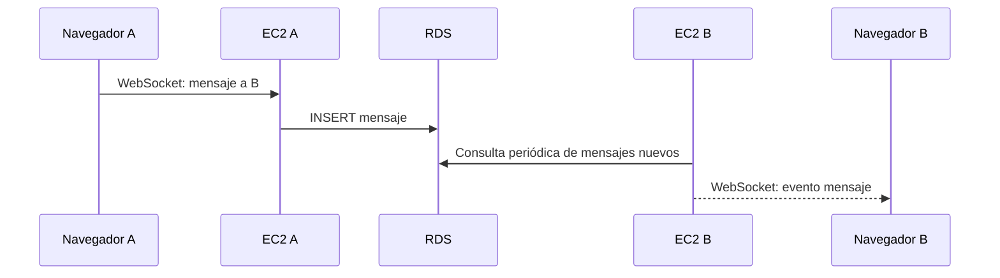

# Chat en tiempo real

> **Responsable:** R4 · Raúl Yat (202300722)  
> **Rúbrica:** 2.11 Chat en tiempo real (3)  
> **Fase:** Fase 1 (desarrollo local) y Fase 3 (prueba con las dos EC2 detrás del ALB)  
> Volver al [manual técnico](../../README.md) · [Plan del equipo](../../docs/plan/distribucion-equipo.md)

## 1. Qué resuelve

- Mensajería en tiempo real entre amigos por WebSocket.
- Cada mensaje se guarda en RDS.
- Cada instancia reenvía a sus propios sockets los mensajes nuevos de RDS, así un mensaje llega aunque el destinatario esté conectado a la otra EC2.

## 2. Servicios de AWS

| Servicio | Recurso | Para qué |
|---|---|---|
| ELB (ALB) | Listener HTTP con *upgrade* a WebSocket | Conexión persistente |
| RDS | Tabla `mensaje` | Historial y puente entre las dos EC2 |

## 3. Contrato de API

Node.js y Python deben responder **exactamente igual**: mismas rutas, mismos códigos HTTP y el
mismo JSON. Cualquier cambio se acuerda aquí antes de programarlo.

| Método | Ruta | Auth | Cuerpo | Respuesta |
|---|---|---|---|---|
| GET | `/chat/{amigoId}/mensajes?desdeId=0` | Bearer | — | `200 {"mensajes":[mensaje...]}` historial incremental, máximo 100 |
| POST | `/chat/{amigoId}/mensajes` | Bearer | `{"texto":"Hola"}` | `201 {"mensaje":mensaje}` |
| POST | `/chat/ticket` | Bearer | — | `200 {"ticket":"...","expiraEn":30}` |
| WS | `/chat?ticket=<ticket>` | Ticket firmado de 30 segundos | `{"tipo":"mensaje","receptorId":2,"texto":"Hola"}` | Evento mensaje/error y `{"tipo":"keepalive"}` cada 25 segundos |

Un mensaje tiene `id`, `emisorId`, `receptorId`, `texto` y `fechaEnvio`. Solo se permite conversar
si ambos aparecen como amigos aceptados.
Las rutas REST usan `401` sin sesión, `403` si no son amigos y `400` para entrada inválida.
El navegador primero solicita un ticket corto por HTTPS con su JWT Bearer y usa ese ticket en el
WebSocket. Así el JWT de acceso no viaja en la URL. Ambas EC2 comparten `WS_TICKET_SECRET` para
validar el ticket. El origen del *handshake* también debe estar en `CORS_ORIGINS`.

## 4. Datos en RDS

`mensaje`. Lee `solicitud_amistad` para validar que sean amigos.

## 5. Flujo

<!-- Diagrama de secuencia en mermaid del caso principal: quién llama a quién y con qué. -->

## 6. Dónde está el código

| Pieza | Carpeta |
|---|---|
| Backend Node.js (EC2 No.1) | [`backend-node/src/chat/`](../../backend-node/src/chat/) |
| Backend Python (EC2 No.2) | [`backend-python/src/chat/`](../../backend-python/src/chat/) |
| Frontend React | [`frontend/src/chat/`](../../frontend/src/chat/) |

## 7. Configuración en AWS

<!-- Paso a paso para reproducir lo configurado: nombre de cada recurso, opciones elegidas y por qué. -->

Habilitar WebSocket en el listener HTTP/HTTPS del ALB (el ALB admite el protocolo `Upgrade`) y
permitir tráfico desde el ALB al puerto `5000` de las dos EC2. El proceso Flask se ejecuta con
varios hilos para sostener sockets mientras atiende peticiones. No se necesita *sticky session*:
cualquier instancia consulta la tabla `mensaje` de RDS y entrega a sus sockets mensajes nuevos.

## 8. Evidencias

Guardar cada captura en [`img/`](img/) con el nombre indicado y enlazarla en esta tabla.

| Archivo | Dónde se toma | Qué debe verse |
|---|---|---|
| `chat-dos-usuarios.png` | Dos navegadores | Una conversación entre dos usuarios, idealmente conectados a EC2 distintas |
| `chat-rds.png` | Cliente MySQL | Los mensajes guardados |

## 9. Preguntas que todo el grupo debe poder responder

1. ¿Cómo llega un mensaje si el destinatario está conectado a la otra EC2?
2. ¿Por qué WebSocket y no consultas periódicas? ¿Cómo pasa el *upgrade* por el ALB?
3. ¿Qué pasa con la conexión si se apaga la EC2 a la que estaba conectado el usuario?
