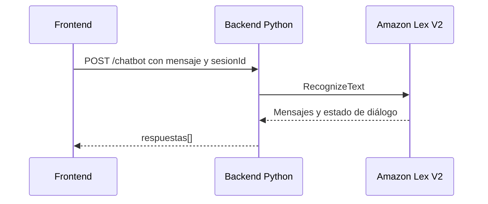

# Chatbot — Amazon Lex

> **Responsable:** R4 · Raúl Yat (202300722)  
> **Rúbrica:** 2.6 Lex (5)  
> **Fase:** Fase 1  
> Volver al [manual técnico](../../README.md) · [Plan del equipo](../../docs/plan/distribucion-equipo.md)

## 1. Qué resuelve

- Botón visible que abre un bot con horarios y preguntas frecuentes de la Facultad de Ingeniería.
- El frontend habla con el backend y este con Lex (`RecognizeText`).
- Lambda de *fulfillment* para respuestas dinámicas (suma valor según el enunciado).

## 2. Servicios de AWS

| Servicio | Recurso | Para qué |
|---|---|---|
| Lex V2 | Bot `proyecto-bot-g8` con su alias | Intenciones de la facultad |
| Lambda | `proyecto-lambda-lex-g8` | Respuestas dinámicas |

## 3. Contrato de API

Node.js y Python deben responder **exactamente igual**: mismas rutas, mismos códigos HTTP y el
mismo JSON. Cualquier cambio se acuerda aquí antes de programarlo.

| Método | Ruta | Auth | Cuerpo | Respuesta |
|---|---|---|---|---|
| POST | `/chatbot` | Bearer | `{"mensaje":"¿Cuál es el horario?","sesionId":"sesion-usuario"}` | `200 {"respuestas":["...", "..."]}` |

Devuelve `401` si no hay sesión, `400` si el mensaje o la sesión no cumplen el formato y `502` si
Lex no responde. El frontend conserva `sesionId` para continuar el diálogo.

## 4. Datos en RDS

No usa tablas propias.

## 5. Flujo

<!-- Diagrama de secuencia en mermaid del caso principal: quién llama a quién y con qué. -->

## 6. Dónde está el código

| Pieza | Carpeta |
|---|---|
| Backend Node.js (EC2 No.1) | [`backend-node/src/chatbot/`](../../backend-node/src/chatbot/) |
| Backend Python (EC2 No.2) | [`backend-python/src/chatbot/`](../../backend-python/src/chatbot/) |
| Frontend React | [`frontend/src/chatbot/`](../../frontend/src/chatbot/) |
| Lambda | [`serverless/chatbot/`](../../serverless/chatbot/) |

## 7. Configuración en AWS

<!-- Paso a paso para reproducir lo configurado: nombre de cada recurso, opciones elegidas y por qué. -->

Configurar las variables `LEX_BOT_ID`, `LEX_BOT_ALIAS_ID` y `LEX_LOCALE` en la EC2. El valor de
locale para español es `es_US`. El instance profile `proyecto-ec2-role-g8` debe poder ejecutar
`lex:RecognizeText` sobre el alias. La integración invoca el runtime Lex V2 desde el backend; la
Lambda `proyecto-lambda-lex-g8` se configura como fulfillment del bot para las intenciones que
necesitan respuestas dinámicas.

## 8. Evidencias

Guardar cada captura en [`img/`](img/) con el nombre indicado y enlazarla en esta tabla.

| Archivo | Dónde se toma | Qué debe verse |
|---|---|---|
| `lex-intents.png` | Lex → Bots → proyecto-bot-g8 → Intents | Las intenciones con sus *utterances* |
| `lex-slots.png` | Lex → Intent → Slots | Los *slots* configurados |
| `lex-alias.png` | Lex → Aliases | El alias y la Lambda asociada |
| `lex-app.png` | Aplicación | El botón y una conversación con el bot |

## 9. Preguntas que todo el grupo debe poder responder

1. ¿Qué es una *intent*, un *slot* y una *utterance*?
2. ¿Para qué sirven la versión y el alias de un bot?
3. ¿Qué hace la Lambda de *fulfillment* y cuándo la llama Lex?
