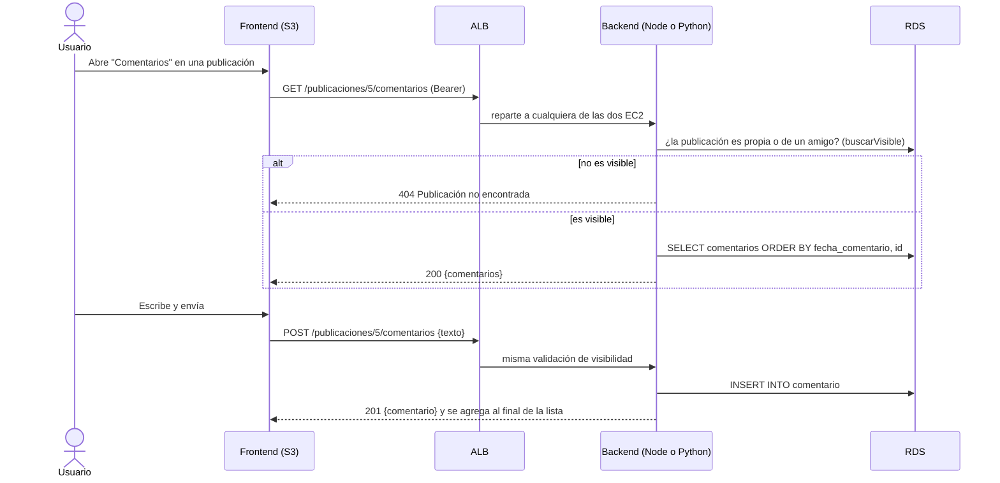

# Comentarios

> **Responsable:** R5 · Fátima Cerezo (202300434)  
> **Rúbrica:** 2.9 Comentarios (3)  
> **Fase:** Fase 1  
> Volver al [manual técnico](../../README.md) · [Plan del equipo](../../docs/plan/distribucion-equipo.md)

## 1. Qué resuelve

- Comentar las publicaciones propias y de amigos.
- Listar los comentarios de cada publicación en orden.

## 2. Servicios de AWS

| Servicio | Recurso | Para qué |
|---|---|---|
| RDS | Tabla `comentario` | Comentarios |

## 3. Contrato de API

Node.js y Python deben responder **exactamente igual**: mismas rutas, mismos códigos HTTP y el
mismo JSON. Cualquier cambio se acuerda aquí antes de programarlo.

Todas las rutas exigen el token (`Authorization: Bearer <token>`); el autor sale del token.

| Método | Ruta | Cuerpo | Respuesta |
|---|---|---|---|
| GET | `/publicaciones/:id/comentarios` | — | `200 {"comentarios": [Comentario]}` |
| POST | `/publicaciones/:id/comentarios` | `{"texto":"..."}` | `201 {"comentario": Comentario}` |

Forma de `Comentario`:

```json
{
  "id": 12,
  "texto": "¡Qué buena foto!",
  "fechaComentario": "2026-10-22T18:30:00Z",
  "autor": { "id": 2, "nombreCompleto": "Isaac Loarca", "fotoPerfilUrl": "https://..." }
}
```

Reglas:

- **Quién puede leer y comentar:** el autor de la publicación y sus amigos (solicitud `ACEPTADA`). Es
  la misma visibilidad del feed de [publicaciones](../publicaciones/README.md); si la publicación no
  existe o no es visible, responde 404 sin revelar que existe.
- **Orden:** del más antiguo al más reciente (como una conversación); en empate, `id` menor primero.
- `texto` se recorta y debe tener de 1 a 1000 caracteres (`VARCHAR(1000)`).
- **Fechas** en UTC con el formato `AAAA-MM-DDTHH:MM:SSZ`, generado en SQL igual que en publicaciones.
- Las rutas viven bajo `/publicaciones/:id`, pero el módulo es propio: se monta aparte del de
  publicaciones y no choca con `GET /publicaciones/:id`.

| Código | Cuándo | Cuerpo |
|---|---|---|
| 400 | Cuerpo no es JSON, `texto` vacío o de más de 1000, o `id` no es entero positivo | `{"error":"..."}` |
| 401 | Sin token o token inválido | `{"error":"..."}` |
| 404 | La publicación no existe o no es visible para el usuario | `{"error":"Publicación no encontrada"}` |

## 4. Datos en RDS

`comentario`. Lee `solicitud_amistad` para validar quién puede comentar.

La visibilidad no se reescribe: el servicio usa `buscarVisible` del repositorio de
[publicaciones](../publicaciones/README.md) (propias y de amigos, por la vista `amistad`). Así
comentarios y feed nunca pueden tener reglas distintas.

## 5. Flujo



## 6. Dónde está el código

| Pieza | Carpeta |
|---|---|
| Backend Node.js (EC2 No.1) | [`backend-node/src/comentarios/`](../../backend-node/src/comentarios/) |
| Backend Python (EC2 No.2) | [`backend-python/src/comentarios/`](../../backend-python/src/comentarios/) |
| Frontend React | [`frontend/src/comentarios/`](../../frontend/src/comentarios/) |

Pruebas: `backend-node/tests/comentarios.test.js` y `backend-python/tests/test_comentarios.py`,
con los mismos casos y el mismo JSON esperado contra la semilla.

## 7. Configuración en AWS

No crea recursos propios. Usa la RDS `proyecto-rds-g8` y la tabla `comentario` del
[esquema](../../database/schema.sql); los backends llegan a ella por el security group
`proyecto-rds-sg-g8`, que solo acepta MySQL desde las EC2 ([plataforma](../plataforma/README.md)).

## 8. Evidencias

Guardar cada captura en [`img/`](img/) con el nombre indicado y enlazarla en esta tabla.

| Archivo | Dónde se toma | Qué debe verse |
|---|---|---|
| `comentarios-app.png` | Aplicación | Una publicación con comentarios de amigos |

## 9. Preguntas que todo el grupo debe poder responder

1. ¿Cómo se valida que solo los amigos comenten?
