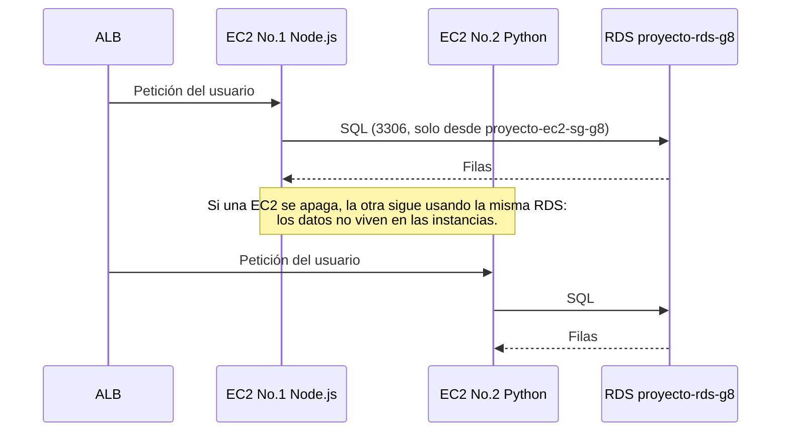

# Datos — Amazon RDS

> **Responsable:** R2 · Valery Alarcón (202300794)  
> **Rúbrica:** 1.5 RDS y lógica (5)  
> **Fase:** Fase 0 (esquema en MySQL local) y Fase 2 (RDS)  
> Volver al [manual técnico](../../README.md) · [Plan del equipo](../../docs/plan/distribucion-equipo.md)

## 1. Qué resuelve

- Esquema relacional de todo el proyecto: usuario, publicación, comentario, etiqueta, publicacion_etiqueta, solicitud_amistad y mensaje.
- Contraseñas guardadas con **MD5** (lo exige la rúbrica) y columna `cognito_sub` para enlazar con Cognito.
- Instancia RDS MySQL sin acceso público desde Internet, alcanzable solo desde las EC2.
- MySQL local en Docker con el mismo esquema para desarrollar sin gastar horas de RDS.

## 2. Servicios de AWS

| Servicio | Recurso | Para qué |
|---|---|---|
| RDS (MySQL 8.4.11) | `proyecto-rds-g8` · `db.t4g.micro` · `proyecto-rds-g8.c83wqyeum4nt.us-east-1.rds.amazonaws.com` | Base de datos de los dos backends |

## 3. Contrato de API

Este dominio no expone endpoints.

## 4. Datos en RDS

Base `semisocial`, MySQL 8.4, todas las tablas InnoDB con `utf8mb4_unicode_ci` (las comparaciones de
texto no distinguen mayúsculas, así el filtro `Dog` = `dog`).


El diagrama se edita en draw.io desde [`Diagrama ER Proyecto.drawio.xml`](Diagrama%20ER%20Proyecto.drawio.xml) y se exporta a [`img/ER-proyecto.drawio.svg`](img/ER-proyecto.drawio.svg).

| Tabla | Dueño que la usa | Qué guarda |
|---|---|---|
| `usuario` | [identidad](../identidad/README.md), [perfil](../perfil/README.md) | Datos del registro, `cognito_sub` y la contraseña en MD5 |
| `solicitud_amistad` | [amistades](../amistades/README.md) | Una fila por pareja de usuarios con su estado |
| `amistad` (vista) | [publicaciones](../publicaciones/README.md), [chat](../chat/README.md) | Las solicitudes `ACEPTADA` en las dos direcciones |
| `publicacion`, `etiqueta`, `publicacion_etiqueta` | [publicaciones](../publicaciones/README.md) | Publicaciones y etiquetas de Rekognition |
| `comentario` | [comentarios](../comentarios/README.md) | Comentarios de cada publicación |
| `mensaje` | [chat](../chat/README.md) | Historial del chat y relevo entre las dos EC2 |

Reglas de diseño:

1. **MD5 en `password_md5 CHAR(32)`.** Lo exige la rúbrica. El backend calcula
   `md5(contraseña)` y guarda los 32 caracteres hexadecimales en minúscula. Cognito guarda su propia
   contraseña por separado; la de RDS no se usa para iniciar sesión.
2. **`cognito_sub` es el puente con Cognito.** El token que valida el backend trae el `sub`; con él
   se busca la fila del usuario. Es `UNIQUE`, igual que `correo` (el *username* de Cognito) y `dpi`.
3. **No se guardan binarios.** De cada imagen se guarda la URL pública (la muestra el frontend) y la
   key del objeto en S3 (la necesita Rekognition: `DetectLabels` en publicaciones y
   `CompareFaces` contra `foto_perfil_key` en el login facial).
4. **La amistad sale de `solicitud_amistad` con estado `ACEPTADA`**, no de una tabla aparte: una
   amistad es una solicitud que se aceptó, y tenerla en dos tablas permitiría que se contradijeran.
   La vista `amistad` la devuelve en las dos direcciones, así "los amigos de X" siempre es
   `WHERE usuario_id = X`.
5. **Una sola solicitud por pareja.** El índice único es sobre la pareja ordenada
   (`LEAST`, `GREATEST`), así que si B ya le envió solicitud a A, A no puede crear otra hacia B.
   Reenviar una rechazada es un `UPDATE` de esa fila a `PENDIENTE`. Un trigger impide enviarse
   solicitud a uno mismo (MySQL no admite `CHECK` sobre columnas con `ON DELETE CASCADE`).
6. **`etiqueta` es un catálogo** con `nombre UNIQUE` y `publicacion_etiqueta` es la tabla intermedia
   del muchos a muchos: una publicación tiene varias etiquetas y una etiqueta está en muchas
   publicaciones. Sin ella habría que repetir el nombre en cada publicación y la lista de filtros
   saldría con duplicados.
7. **`mensaje.fecha_envio` con milisegundos** e `id BIGINT`: el relevo del chat entre las dos EC2
   pide "mensajes con `id` mayor al último que entregué", y el índice `(receptor_id, id)` cubre esa
   consulta.
8. **`ON DELETE CASCADE`** en todas las claves foráneas: si se borra un usuario no quedan filas
   huérfanas.
9. **Fechas en UTC.** RDS trabaja en UTC por defecto; los backends deben abrir la sesión con
   `time_zone = '+00:00'`.

## 5. Flujo



## 6. Dónde está el código

| Pieza | Carpeta |
|---|---|
| Esquema (`schema.sql`), datos de prueba (`seed.sql`) y MySQL local (`docker-compose.yml`) | [`database/`](../../database/) |

**Desarrollo en local** (fases 0 a 2, sin gastar horas de RDS):

```bash
docker compose -f Proyecto/database/docker-compose.yml up -d      # MySQL 8.4 en el puerto 3306, carga schema y seed
docker compose -f Proyecto/database/docker-compose.yml down -v    # borra todo; el próximo up vuelve a cargar
docker exec -i semisocial-mysql mysql -uroot -proot < Proyecto/database/seed.sql   # recargar solo los datos
```

Conexión local: host `127.0.0.1`, puerto `3306`, base `semisocial`, usuario `root` / `root`.

**Datos de prueba** (`seed.sql`): 6 usuarios con contraseña `Demo1234`
(`MD5 = fd6138204c4eb1dd19e63896c1557e27`), con correos `<nombre>.demo@semisocial.test`. Desde
`valery.demo` (id 1): es amiga de isaac (2) y raul (3); fatima (4) le envió una solicitud pendiente;
la que ella le envió a daniel (5) fue rechazada; ana (6) no tiene relación con nadie. Hay 6
publicaciones con etiquetas, 5 comentarios y 3 mensajes. Estos usuarios **no existen en Cognito**
(su `cognito_sub` es inventado): sirven para desarrollar contra datos, no para iniciar sesión.

## 7. Configuración en AWS

Creada el 21/10/2026 desde la consola (RDS → Bases de datos → Crear base de datos) con el usuario
`proyecto-dev-valery-g8`. La credencial maestra **no** está en el repositorio: se comparte por canal
privado.

### 7.1 La instancia

| Opción de la consola | Valor | Por qué |
|---|---|---|
| Método de creación | Configuración completa | Para controlar cada opción de costo y de red |
| Motor / edición / versión | MySQL Community **8.4.11** | El soporte estándar de 8.0 en RDS terminó y usarla exige *RDS Extended Support*, que se cobra por hora. *Activar el soporte extendido* quedó **desmarcado** |
| Plantilla | Entorno de pruebas | Restringe a clases pequeñas y una zona, dentro del plan Free |
| Disponibilidad | **Instancia única (single-AZ)** | Multi-AZ duplica el costo con una réplica en espera. La alta disponibilidad que pide el proyecto es la de las EC2 detrás del ALB |
| Identificador | `proyecto-rds-g8` | Convención de nombres del grupo |
| Usuario maestro | `admin`, credenciales autoadministradas | Secrets Manager cobra por secreto al mes |
| Clase | `db.t4g.micro` (2 vCPU, 1 GiB, Graviton) | La más pequeña de la familia ampliable |
| Almacenamiento | 20 GiB gp3 (3000 IOPS, 125 MiBps incluidos) · **escalado automático desactivado** | Con escalado activado RDS agrega disco por su cuenta y ese disco se cobra. La base solo guarda texto y URL |
| Recurso de computación | No conectarse a un recurso EC2 | La conexión con las EC2 se hace con el security group, no con el asistente (que crea grupos propios) |
| VPC / subredes | Default VPC `vpc-0334ee6d4cba6194c` / grupo predeterminado | La misma VPC donde viven las EC2. No se puede cambiar después |
| Acceso público | **Sí, temporal** (ver §7.2) | Para desarrollar y cargar el esquema desde las computadoras del equipo |
| Grupo de seguridad | **Solo** `proyecto-rds-sg-g8` (`sg-0a048716dbb3d919e`), sin el `default` | Ver [plataforma §7.6](../plataforma/README.md) |
| Zona de disponibilidad | Sin preferencia (quedó en `us-east-1f`) | — |
| Puerto | 3306 | — |
| Base de datos inicial | `semisocial` | La que usan los backends |
| Grupo de parámetros / opciones | `default.mysql8.4` / `default:mysql-8-4` | La zona horaria por defecto de RDS es UTC, que es lo que asumen los backends |
| Cifrado | Activado con la clave `aws/rds` | No tiene costo |
| Copias de seguridad automatizadas | Activadas, retención de 1 día | El mínimo; los datos de prueba se pueden recargar con `seed.sql` |
| Supervisión | Database Insights estándar; monitorización mejorada, Performance Insights avanzado y exportación de registros **desactivados** | Los tres últimos cobran |
| Protección contra eliminación | Desactivada | Todo se da de baja el 28/10 |
| Etiqueta | `Proyecto=proyecto-g8` | Para encontrar y dar de baja los recursos del grupo |

**Endpoint:** `proyecto-rds-g8.c83wqyeum4nt.us-east-1.rds.amazonaws.com`, puerto `3306`, base `semisocial`.

### 7.2 Acceso de red

`proyecto-rds-sg-g8` admite el 3306 desde `proyecto-ec2-sg-g8` (regla permanente) y, mientras se
desarrolla, desde la IP `/32` de cada integrante que lo necesite, con su nombre como descripción.
El domingo 25, antes de la calificación, se borran las reglas de IP y se desactiva el acceso público:

```bash
aws rds modify-db-instance --db-instance-identifier proyecto-rds-g8 --no-publicly-accessible --apply-immediately
```

### 7.3 Carga del esquema

Sin cliente `mysql` instalado, se usa el del contenedor de desarrollo, que ya tiene montados los dos
scripts:

```bash
docker exec -it semisocial-mysql mysql -h proyecto-rds-g8.c83wqyeum4nt.us-east-1.rds.amazonaws.com -u admin -p
mysql> source /docker-entrypoint-initdb.d/01-schema.sql
mysql> source /docker-entrypoint-initdb.d/02-seed.sql
```

Resultado el 21/10/2026: 7 tablas InnoDB `utf8mb4_unicode_ci` más la vista `amistad`, y 6 usuarios,
5 solicitudes, 6 publicaciones, 12 etiquetas, 15 relaciones publicación-etiqueta, 5 comentarios y
3 mensajes de prueba.

## 8. Evidencias

Guardar cada captura en [`img/`](img/) con el nombre indicado y enlazarla en esta tabla.

| Archivo | Dónde se toma | Qué debe verse |
|---|---|---|
| [`rds-creada.png`](img/rds-creada.png) | RDS → Bases de datos | `proyecto-rds-g8` *Disponible*, `db.t4g.micro`, Multi-AZ = No |
| [`rds-conectividad-hoy.png`](img/rds-conectividad-hoy.png) | RDS → proyecto-rds-g8 → Conectividad y seguridad | Motor MySQL Community, clase, zona y endpoint |
| `rds-conectividad.png` (domingo) | RDS → Connectivity & security | Security group `proyecto-rds-sg-g8` y *Publicly accessible* = No |
| `rds-tablas.png` (sábado o domingo) | Cliente MySQL conectado desde una EC2 | `SHOW TABLES;` y un usuario con su `password_md5` |


## 9. Preguntas que todo el grupo debe poder responder

1. **Dibujar el modelo entidad-relación y explicar por qué la amistad sale de `solicitud_amistad` aceptada.**

   Son 7 tablas con `usuario` al centro (ver el diagrama de §4). Un usuario tiene muchas
   publicaciones, comentarios, solicitudes y mensajes (1 : N). Publicación y etiqueta son muchos a
   muchos, resuelto con `publicacion_etiqueta`. `solicitud_amistad` y `mensaje` tienen **dos** llaves
   foráneas a `usuario` (emisor y receptor). Una amistad **es** una solicitud que se aceptó: si
   existiera una tabla `amistad` aparte, el mismo hecho quedaría guardado dos veces y las dos tablas
   podrían contradecirse (una amistad sin solicitud aceptada, o al revés). Para no tener que revisar
   emisor y receptor en cada consulta, la vista `amistad` devuelve cada amistad en las dos
   direcciones.

2. **¿Por qué MD5 no es seguro hoy? ¿Qué se usaría en producción?**

   MD5 se diseñó para ser **rápido**: una GPU calcula miles de millones de hashes por segundo, así
   que probar contraseñas por fuerza bruta o con diccionario es barato. Además, no lleva sal: la
   misma contraseña produce siempre el mismo hash (en el seed, los 6 usuarios con `Demo1234` tienen
   el mismo `password_md5`), lo que permite usar tablas precalculadas. En producción se usa un
   algoritmo **lento a propósito, con sal y factor de costo**: bcrypt (el que usamos en la
   Práctica 2), scrypt o Argon2.

3. **Si Cognito ya guarda la contraseña, ¿para qué se guarda también en RDS?**

   Porque la rúbrica lo exige (criterio 1.5: "contraseñas en MD5"). El inicio de sesión lo resuelve
   **Cognito**, que guarda su propia contraseña con su propio algoritmo; la copia en MD5 de RDS no se
   usa para autenticar. RDS guarda el resto de los datos del usuario y se enlaza con Cognito por la
   columna `cognito_sub`.

4. **¿Qué pasa con la base de datos si se apaga una de las EC2?**

   Nada. La base no vive en las EC2: es un servicio aparte (Amazon RDS) al que las dos instancias se
   conectan por la red en el puerto 3306. Si una EC2 se apaga, el ALB manda todo el tráfico a la
   otra, que lee y escribe sobre la misma RDS, así que no se pierde ningún dato.
