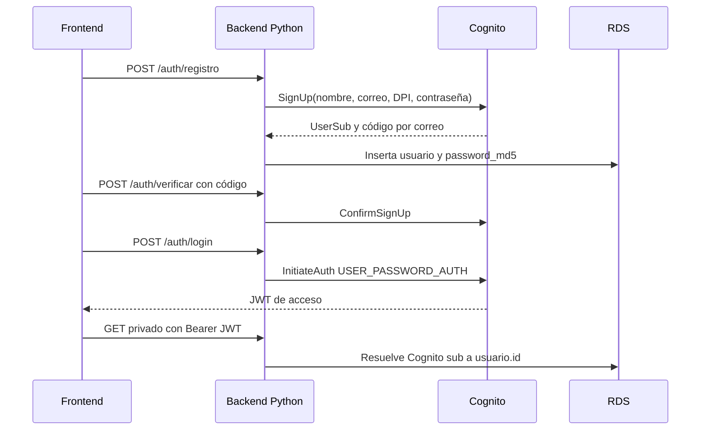

# Identidad — registro, verificación y login

> **Responsable:** R3 · Isaac Loarca (202307546)  
> **Rúbrica:** 2.1 Cognito (7) · 2.2 Rekognition, login facial (3 de 6) · 2.7 Registro y login (3)  
> **Fase:** Fase 1  
> Volver al [manual técnico](../../README.md) · [Plan del equipo](../../docs/plan/distribucion-equipo.md)

## 1. Qué resuelve

- Registro con nombre completo, correo, DPI, contraseña, confirmación y foto de perfil (archivo o webcam).
- Verificación por correo con el código de Cognito.
- Login con usuario y contraseña, y login facial: `CompareFaces` contra la foto de perfil en S3.
- Los dos logins pasan por Cognito. El facial usa el flujo `CUSTOM_AUTH` con triggers Lambda.
- Cada registro escribe en Cognito **y** en RDS (`cognito_sub`, `password_md5`).

## 2. Servicios de AWS

| Servicio | Recurso | Para qué |
|---|---|---|
| Cognito | User pool `proyecto-userpool-g8` con atributo `custom:dpi` | Registro, verificación por correo y tokens |
| Rekognition | `CompareFaces` | Login facial |
| Lambda | Triggers *Define / Create / Verify auth challenge* | Flujo `CUSTOM_AUTH` del login facial |
| RDS | Tabla `usuario` | Datos del usuario y contraseña en MD5 |

## 3. Contrato de API

Node.js y Python deben responder **exactamente igual**: mismas rutas, mismos códigos HTTP y el
mismo JSON. Cualquier cambio se acuerda aquí antes de programarlo.

| Método | Ruta | Auth | Cuerpo | Respuesta |
|---|---|---|---|---|
| POST | `/auth/registro` | Público | `{"nombreCompleto","correo","dpi","password","fotoPerfilKey"}` | `201 {"mensaje":"Cuenta creada. Revisa tu correo para verificarla."}` |
| POST | `/auth/verificar` | Público | `{"correo","codigo"}` | `200 {"mensaje":"Correo verificado"}` |
| POST | `/auth/reenviar-codigo` | Público | `{"correo"}` | `200 {"mensaje":"Código reenviado"}` |
| POST | `/auth/login` | Público | `{"correo","password"}` | `200 {"token":"<Cognito access token>"}` |
| POST | `/auth/login-facial` | Público | `{"correo","imagen":"data:image/jpeg;base64,..."}` | `200 {"token":"<Cognito access token>"}` |

El registro crea la cuenta en Cognito y en RDS; RDS guarda el hash MD5 que exige la rúbrica.
El login facial compara la captura con la foto de `Fotos_Perfil` mediante Rekognition y luego
completa `CUSTOM_AUTH` en Cognito. El error `403` del login con contraseña indica que falta verificar
el correo, como espera el frontend.

## 4. Datos en RDS

`usuario` (escritura en el registro, lectura en el login).

## 5. Flujo

<!-- Diagrama de secuencia en mermaid del caso principal: quién llama a quién y con qué. -->

## 6. Dónde está el código

| Pieza | Carpeta |
|---|---|
| Backend Node.js (EC2 No.1) | [`backend-node/src/identidad/`](../../backend-node/src/identidad/) |
| Backend Python (EC2 No.2) | [`backend-python/src/identidad/`](../../backend-python/src/identidad/) |
| Frontend React | [`frontend/src/identidad/`](../../frontend/src/identidad/) |
| Lambda | [`serverless/identidad/`](../../serverless/identidad/) |

## 7. Configuración en AWS

<!-- Paso a paso para reproducir lo configurado: nombre de cada recurso, opciones elegidas y por qué. -->

Configurar el User Pool `proyecto-userpool-g8` con correo como nombre de usuario, el atributo
personalizado `custom:dpi` escribible por el App Client y verificación de correo. En el App Client activar
`ALLOW_USER_PASSWORD_AUTH` y `ALLOW_CUSTOM_AUTH`; si se genera client secret, configurarlo en
`COGNITO_CLIENT_SECRET` del backend. Asignar los triggers de autenticación personalizados
`DefineAuthChallenge`, `CreateAuthChallenge` y `VerifyAuthChallengeResponse` desde
[`serverless/identidad/custom_auth.py`](../../serverless/identidad/custom_auth.py). El backend y
las Lambdas deben compartir `FACIAL_AUTH_SECRET` aleatorio de al menos 32 caracteres, configurado
fuera de Git. El backend responde el reto con un HMAC del secreto y el nonce de Cognito; la Lambda
falla cerrada si el secreto falta o la firma no coincide.
El rol de EC2 necesita `cognito-idp:AdminUpdateUserAttributes` para edición de perfil,
`cognito-idp:AdminDeleteUser` para compensar fallos durante el registro y permisos de
`rekognition:CompareFaces` y `s3:GetObject` sobre `Fotos_Perfil/*`.

`CORS_ORIGINS` debe listar los orígenes exactos desde donde se sirve el frontend. La API valida la
firma y el `issuer` del JWT, exige `token_use=access` y el App Client esperado, y resuelve `sub` a la
fila de RDS antes de permitir rutas privadas.

## 8. Evidencias

Guardar cada captura en [`img/`](img/) con el nombre indicado y enlazarla en esta tabla.

| Archivo | Dónde se toma | Qué debe verse |
|---|---|---|
| `cognito-pool.png` | Cognito → User pools → proyecto-userpool-g8 | Resumen del pool y atributos, incluido `custom:dpi` |
| `cognito-usuarios.png` | Cognito → Users | Usuarios registrados con estado `Confirmed` |
| `cognito-correo.png` | Bandeja de entrada | El correo de verificación recibido |
| `cognito-triggers.png` | Cognito → Extensions / Lambda triggers | Los triggers del flujo `CUSTOM_AUTH` |
| `app-login-facial.png` | Aplicación | Login facial exitoso |

## 9. Preguntas que todo el grupo debe poder responder

1. ¿Qué diferencia hay entre un *user pool* y un *identity pool*?
2. Paso a paso, ¿cómo funciona el login facial y por qué sigue pasando por Cognito?
3. ¿Qué es el `sub` de Cognito y por qué se guarda en RDS?
4. ¿Qué umbral de similitud se usa en `CompareFaces` y qué pasa si la foto no tiene rostro? Se
   exige 90%; si no hay coincidencia devuelve `401`, y si la imagen no es válida devuelve `400`.
