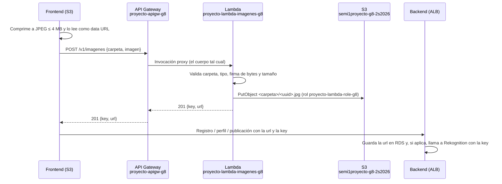

# Imágenes — carga por API Gateway, Lambda y S3

> **Responsable:** R1 · Daniel Hernández (202300512)  
> **Rúbrica:** 1.2 S3 (5) · 2.3 Lambda (4) · 2.4 API Gateway (4)  
> **Fase:** Fase 1  
> Volver al [manual técnico](../../README.md) · [Plan del equipo](../../docs/plan/distribucion-equipo.md)

## 1. Qué resuelve

- Endpoint obligatorio de API Gateway que recibe la imagen y la entrega a Lambda.
- Lambda que guarda la imagen en `semi1proyecto-g8-2s2026` dentro de `Fotos_Perfil/` o `Fotos_Publicadas/` y devuelve la URL pública.
- Lectura pública de ambas carpetas.
- El frontend valida y comprime antes de subir (API Gateway acepta máximo 10 MB).

## 2. Servicios de AWS

| Servicio | Recurso | Para qué |
|---|---|---|
| API Gateway | `proyecto-apigw-g8` | Puerta de entrada de las cargas |
| Lambda | `proyecto-lambda-imagenes-g8` + rol `proyecto-lambda-role-g8` | Guarda la imagen en S3 |
| S3 | `semi1proyecto-g8-2s2026` (`Fotos_Perfil/`, `Fotos_Publicadas/`) | Almacenamiento con lectura pública |

## 3. Contrato de API

Este endpoint **no está en los backends**: el frontend lo llama directo en API Gateway. La URL base
está en `IMAGENES_API_URL` (`Proyecto/secrets/aws-iam.env`):

```
POST https://mkg1a6f2g9.execute-api.us-east-1.amazonaws.com/v1/imagenes
Content-Type: application/json
```

| Método | Ruta | Auth | Cuerpo | Respuesta |
|---|---|---|---|---|
| POST | /imagenes | No | `{"carpeta":"Fotos_Perfil"\|"Fotos_Publicadas","imagen":"data:image/jpeg;base64,..."}` | `201 {"key":"Fotos_Perfil/<uuid>.jpg","url":"https://semi1proyecto-g8-2s2026.s3.amazonaws.com/Fotos_Perfil/<uuid>.jpg"}` |

| Código | Cuándo | Cuerpo |
|---|---|---|
| 400 | El cuerpo no es JSON, `carpeta` no es una de las dos o `imagen` no es un *data URL* en base64 | `{"error":"..."}` |
| 413 | La imagen pasa de 4 MB, o la petición completa pasa de 6 MB (lo corta Lambda antes de ejecutar) | `{"error":"..."}` o `{"message":"..."}` |
| 415 | No es JPEG ni PNG, o los bytes no coinciden con el tipo declarado | `{"error":"..."}` |
| 429 | Más de 10 peticiones por segundo (ráfaga de 20) | `{"message":"Too Many Requests"}` |

Reglas para quien lo consume:

- **Solo JPEG o PNG**: son los únicos formatos que Rekognition acepta para etiquetas y login facial.
- **Máximo 4 MB de imagen.** El frontend debe comprimir antes (por ejemplo con `canvas.toBlob`
  a JPEG) y mandar el resultado de `FileReader.readAsDataURL` tal cual.
- El nombre del archivo lo genera la Lambda (`<uuid>.<ext>`), así dos usuarios nunca se pisan.
- Se guarda la **`url`** en RDS (perfil y publicaciones) y la **`key`** se usa con Rekognition
  (`S3Object={Bucket:"semi1proyecto-g8-2s2026", Name:key}`).
- No lleva token porque el registro sube la foto de perfil antes de que el usuario exista en Cognito.
  La protección es la validación de tipo y tamaño y el límite de peticiones del stage.

## 4. Datos en RDS

No escribe en RDS. Devuelve la URL y quien la pidió ([identidad](../identidad/README.md), [perfil](../perfil/README.md), [publicaciones](../publicaciones/README.md)) la guarda.

## 5. Flujo



## 6. Dónde está el código

| Pieza | Carpeta |
|---|---|
| Lambda | [`serverless/imagenes/`](../../serverless/imagenes/) |
| Cliente de carga y compresión (frontend) | [`frontend/src/imagenes/`](../../frontend/src/imagenes/) |

## 7. Configuración en AWS

### 7.1 Bucket `semi1proyecto-g8-2s2026`

Lo crea [`infra/scripts/iam-s3.sh`](../../infra/scripts/iam-s3.sh) junto con IAM (ver
[plataforma §7](../plataforma/README.md#7-configuración-en-aws)).

| Opción | Valor | Por qué |
|---|---|---|
| Nombre | `semi1proyecto-g8-2s2026` | `semi1proyecto-g8` ya lo tiene otra cuenta de AWS (`BucketAlreadyExists`); el espacio de nombres de S3 es global |
| Región | `us-east-1` | La misma de todo el proyecto |
| Object Ownership | *Bucket owner enforced* (ACL desactivadas) | El acceso público se da con la *bucket policy*, no con ACL por objeto |
| Block Public Access | Solo `BlockPublicAcls` e `IgnorePublicAcls` activos | Hay que desactivar los dos de políticas para que la *bucket policy* pública surta efecto |
| Bucket policy | [`infra/s3/semi1proyecto-g8-2s2026-policy.json`](../../infra/s3/semi1proyecto-g8-2s2026-policy.json) | `s3:GetObject` público **solo** en `Fotos_Perfil/*` y `Fotos_Publicadas/*`; lo demás queda privado |
| CORS | [`infra/s3/semi1proyecto-g8-2s2026-cors.json`](../../infra/s3/semi1proyecto-g8-2s2026-cors.json) | `GET`/`HEAD` desde cualquier origen, por si el frontend lee la imagen con `fetch` o `canvas` |
| Carpetas | Objetos vacíos `Fotos_Perfil/` y `Fotos_Publicadas/` | Para que existan en la consola antes de la primera carga |
| Etiqueta | `Proyecto=proyecto-g8` | Para encontrarlo y darlo de baja |

URL pública de un objeto: `https://semi1proyecto-g8-2s2026.s3.amazonaws.com/Fotos_Perfil/<archivo>`.

Verificación (21/10/2026): un objeto en cada carpeta responde `200` sin credenciales y uno en la
raíz del bucket responde `403`.

### 7.2 Quién escribe en el bucket

| Identidad | Permiso | Uso |
|---|---|---|
| Rol `proyecto-lambda-role-g8` | `s3:PutObject` solo en las dos carpetas | La Lambda de imágenes |
| Usuario `proyecto-iam-s3-g8` | Leer, escribir y borrar objetos | Pruebas y limpieza desde la CLI |
| Usuario `proyecto-iam-rekognition-g8` y rol de las EC2 | `s3:GetObject` en las dos carpetas | Rekognition lee la imagen con los permisos de quien lo llama |

### 7.3 Lambda `proyecto-lambda-imagenes-g8`

Se despliega con [`infra/scripts/imagenes.sh`](../../infra/scripts/imagenes.sh), que también crea
la API. Si se vuelve a correr, sube el código nuevo y redespliega el stage.

| Opción | Valor | Por qué |
|---|---|---|
| Runtime | Node.js 22.x, `arm64` | El SDK v3 de AWS ya viene incluido, así que el zip es solo `index.mjs`. Graviton cuesta menos por ms |
| Handler | `index.handler` | [`serverless/imagenes/index.mjs`](../../serverless/imagenes/index.mjs) |
| Rol | `proyecto-lambda-role-g8` | Solo `PutObject` en las dos carpetas y sus logs |
| Memoria / timeout | 256 MB / 15 s | Decodificar base64 de 4 MB y subirlo tarda menos de 1 s |
| Variable de entorno | `BUCKET=semi1proyecto-g8-2s2026` | El nombre no queda fijo en el código |
| Logs | `/aws/lambda/proyecto-lambda-imagenes-g8`, retención 14 días | Se crea antes que la función para que no quede con retención infinita |

### 7.4 API Gateway `proyecto-apigw-g8`

| Opción | Valor | Por qué |
|---|---|---|
| Tipo | API REST, *Regional* | Muestra recursos, métodos y stages por separado (lo que pide la evidencia) |
| Recurso | `/imagenes` | |
| `POST` | Integración `AWS_PROXY` con la Lambda, sin autorización | La Lambda arma toda la respuesta, CORS incluido. Sin *binary media types*: la imagen viaja como texto base64 dentro del JSON |
| `OPTIONS` | Integración `MOCK` que responde 200 con `Access-Control-Allow-Origin: *`, `Allow-Methods: OPTIONS,POST` y `Allow-Headers: Content-Type` | *Preflight* de CORS del navegador, sin invocar la Lambda |
| Gateway responses | `DEFAULT_4XX` y `DEFAULT_5XX` con `Access-Control-Allow-Origin: *` | Para que el frontend pueda leer un 413 o un 429 generado por API Gateway |
| Permiso de invocación | `lambda:InvokeFunction` para `apigateway.amazonaws.com` con `SourceArn` `.../mkg1a6f2g9/*/POST/imagenes` | Solo ese método de esa API puede invocarla |
| Stage | `v1`, *throttling* de 10 req/s con ráfaga de 20 | Como la ruta es pública, el límite evita que llenen el bucket o disparen la factura |

Límites que importan:

| Límite | Valor | Cómo se maneja |
|---|---|---|
| Carga útil de API Gateway | 10 MB | No se llega: Lambda corta antes |
| Carga útil de una invocación síncrona de Lambda | 6 MB | Por eso el máximo es 4 MB de imagen (base64 agrega ~33 %) |
| Timeout de integración de API Gateway | 29 s | La Lambda tarda menos de 1 s |

Verificación (21/10/2026): un PNG válido devuelve `201` y queda público con `Content-Type: image/png`.
Rekognition `DetectLabels` lo lee con el usuario `proyecto-iam-rekognition-g8`. Los casos de error
devuelven `400`, `415` y `413`, este último con CORS. El *preflight* responde `200`, y el log de la
carga aparece en CloudWatch.

## 8. Evidencias

Guardar cada captura en [`img/`](img/) con el nombre indicado y enlazarla en esta tabla.

| Archivo | Dónde se toma | Qué debe verse |
|---|---|---|
| `s3-imagenes.png` | S3 → semi1proyecto-g8-2s2026 | Las carpetas `Fotos_Perfil/` y `Fotos_Publicadas/` con archivos |
| `s3-politica.png` | S3 → semi1proyecto-g8-2s2026 → Permissions | La *bucket policy* de lectura pública |
| `apigw-recurso.png` | API Gateway → Resources | El recurso, el método y la integración con Lambda |
| `apigw-stage.png` | API Gateway → Stages | La URL de invocación |
| `lambda-funcion.png` | Lambda → proyecto-lambda-imagenes-g8 | El código y el trigger de API Gateway |
| `lambda-logs.png` | CloudWatch → Log groups | El registro de una carga exitosa |

## 9. Preguntas que todo el grupo debe poder responder

1. ¿Por qué las imágenes pasan por API Gateway y Lambda y no por el backend?
2. ¿Qué límites tiene API Gateway en tamaño y tiempo, y cómo se manejan?
3. ¿Cómo viaja un archivo binario por API Gateway? (base64, *binary media types*)
4. ¿Qué permisos tiene el rol de la Lambda y por qué no más?
