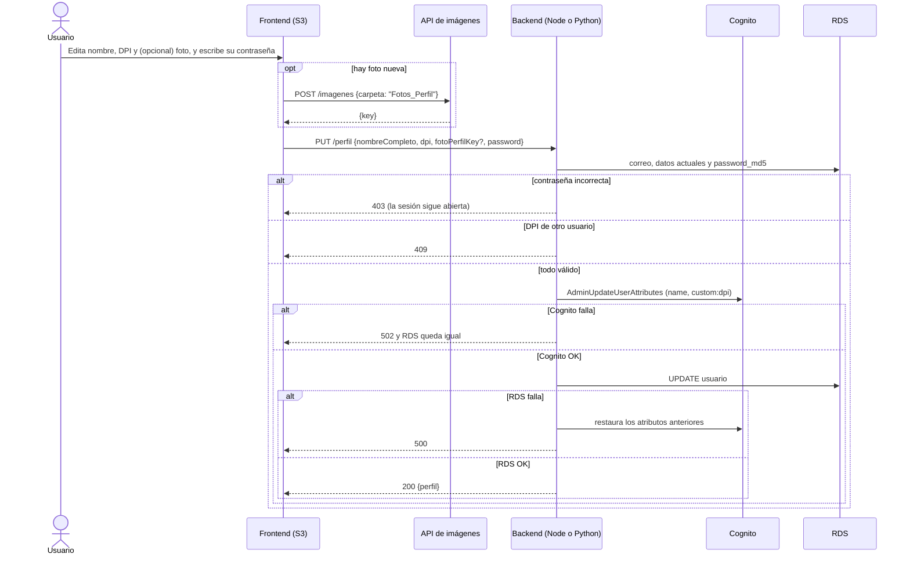

# Perfil — edición de datos del usuario

> **Responsable:** R5 · Fátima Cerezo (202300434)  
> **Rúbrica:** Parte de 2.1 Cognito (sincronización RDS ↔ Cognito)  
> **Fase:** Fase 1  
> Volver al [manual técnico](../../README.md) · [Plan del equipo](../../docs/plan/distribucion-equipo.md)

## 1. Qué resuelve

- Modificar nombre completo, DPI y foto de perfil.
- Exigir la contraseña actual para guardar.
- Reflejar los cambios en RDS **y** en Cognito. La nueva foto pasa a ser la del login facial.

## 2. Servicios de AWS

| Servicio | Recurso | Para qué |
|---|---|---|
| Cognito | `AdminUpdateUserAttributes` | Actualizar `name` y `custom:dpi` |
| S3 (vía [imágenes](../imagenes/README.md)) | `Fotos_Perfil/` | Nueva foto de perfil |
| RDS | Tabla `usuario` | Datos del perfil |

## 3. Contrato de API

Node.js y Python deben responder **exactamente igual**: mismas rutas, mismos códigos HTTP y el
mismo JSON. Cualquier cambio se acuerda aquí antes de programarlo.

Todas las rutas exigen el token (`Authorization: Bearer <token>`). El id del usuario sale siempre
del token, nunca del cuerpo ni de la ruta: cada quien solo ve y edita su propio perfil.

| Método | Ruta | Cuerpo | Respuesta |
|---|---|---|---|
| GET | `/perfil` | — | `200 {"perfil": Perfil}` |
| PUT | `/perfil` | `{"nombreCompleto":"...","dpi":"1234567890101","fotoPerfilKey":"Fotos_Perfil/<uuid>.jpg","password":"..."}` | `200 {"perfil": Perfil}` |

Forma de `Perfil`:

```json
{
  "id": 1,
  "nombreCompleto": "Fátima Cerezo",
  "correo": "fatima@correo.com",
  "dpi": "1234567890101",
  "fotoPerfilUrl": "https://semi1proyecto-g8-2s2026.s3.amazonaws.com/Fotos_Perfil/<uuid>.jpg"
}
```

Reglas:

- **El correo no se edita:** es el nombre de usuario en Cognito.
- **`fotoPerfilKey` es opcional.** Si viene, el frontend ya subió la foto a la API de
  [imágenes](../imagenes/README.md) con `carpeta: "Fotos_Perfil"`. Debe ser
  `Fotos_Perfil/<archivo>.jpg|.jpeg|.png`. El backend arma la URL pública a partir de la key, igual
  que [publicaciones](../publicaciones/README.md), y actualiza `foto_perfil_url` y `foto_perfil_key`.
  La nueva foto pasa a ser la del login facial.
- **`password` es la contraseña actual** y es obligatoria. Se compara su MD5 con `password_md5`.
- `nombreCompleto` se recorta y debe tener de 1 a 150 caracteres. `dpi` son exactamente 13 dígitos.
- **Orden de escritura:** validar → comprobar contraseña → Cognito (`AdminUpdateUserAttributes` con
  `name` y `custom:dpi`) → RDS. Si RDS falla, se restauran en Cognito los atributos anteriores, para
  que las dos fuentes nunca queden distintas.

| Código | Cuándo | Cuerpo |
|---|---|---|
| 400 | Cuerpo no es JSON, `nombreCompleto` vacío o de más de 150, `dpi` sin 13 dígitos, `fotoPerfilKey` con otra forma, o falta `password` | `{"error":"..."}` |
| 401 | Sin token o token inválido (middleware de [identidad](../identidad/README.md)) | `{"error":"..."}` |
| 403 | La contraseña no coincide. **No es 401**, para que el frontend no cierre la sesión por un error de tecleo | `{"error":"La contraseña no es correcta"}` |
| 409 | El DPI ya pertenece a otro usuario | `{"error":"Ese DPI ya está registrado"}` |
| 502 | Cognito falló. **No se cambia nada** en RDS | `{"error":"No se pudo actualizar el perfil en Cognito"}` |

## 4. Datos en RDS

`usuario` (lectura y actualización).

## 5. Flujo



## 6. Dónde está el código

| Pieza | Carpeta |
|---|---|
| Backend Node.js (EC2 No.1) | [`backend-node/src/perfil/`](../../backend-node/src/perfil/) |
| Backend Python (EC2 No.2) | [`backend-python/src/perfil/`](../../backend-python/src/perfil/) |
| Frontend React | [`frontend/src/perfil/`](../../frontend/src/perfil/) |
| Cliente de Cognito | [`backend-node/src/infrastructure/aws/cognito.js`](../../backend-node/src/infrastructure/aws/cognito.js) · [`backend-python/src/infrastructure/aws/cognito.py`](../../backend-python/src/infrastructure/aws/cognito.py) |

Pruebas: `backend-node/tests/perfil.test.js` y `backend-python/tests/test_perfil.py`, con los mismos
casos y el mismo JSON esperado contra la semilla. Cognito va simulado: las pruebas comprueban qué
atributos se le mandan y que se restauran si RDS falla.

## 7. Configuración en AWS

No crea recursos propios. Usa el user pool `proyecto-userpool-g8` de [identidad](../identidad/README.md),
donde el nombre de usuario es el correo y el DPI vive en el atributo `custom:dpi`.

| Quién llama | Credenciales | Permiso |
|---|---|---|
| Backends en las EC2 | Rol `proyecto-ec2-role-g8` (sin llaves) | [`proyecto-cognito-policy-g8`](../../infra/iam/politicas/proyecto-cognito-policy-g8.json) |
| Backends en local | Usuario `proyecto-iam-cognito-g8` (`COGNITO_ACCESS_KEY_ID` y `COGNITO_SECRET_ACCESS_KEY`) | La misma política |

De esa política, perfil solo usa `cognito-idp:AdminUpdateUserAttributes`. Los clientes eligen las
credenciales con `credencialesDe('COGNITO')` (`credenciales_de` en Python): si existen las variables
de la llave las usan; si no, el SDK toma el rol de la EC2.

## 8. Evidencias

Guardar cada captura en [`img/`](img/) con el nombre indicado y enlazarla en esta tabla.

| Archivo | Dónde se toma | Qué debe verse |
|---|---|---|
| `perfil-app.png` | Aplicación | El formulario de edición antes y después de guardar |
| `perfil-cognito.png` | Cognito → Users → usuario | Los atributos ya actualizados |
| `perfil-rds.png` | Cliente MySQL | La fila del usuario ya actualizada |

## 9. Preguntas que todo el grupo debe poder responder

1. ¿Cómo se valida la contraseña antes de guardar?
2. ¿Qué pasa si Cognito se actualiza pero RDS falla? ¿Cómo se evita que queden distintos?
