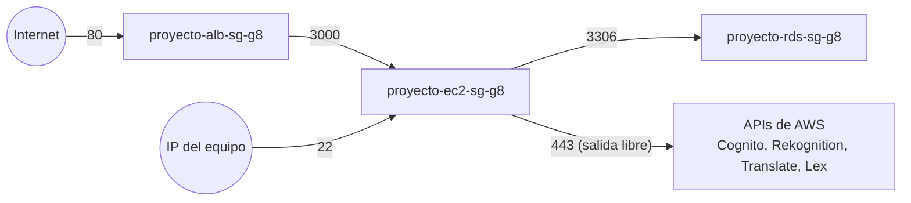

# Plataforma — IAM, red, cómputo, balanceo y hosting

> **Responsable:** R1 · Daniel Hernández (202300512)  
> **Rúbrica:** 1.1 IAM (5) · 1.6 Security groups (5) · 1.7 Balanceador (5) · 1.8 Hosting web (5) · despliegue de 1.3 y 1.4  
> **Fase:** Fase 1 (IAM) y Fase 3 (EC2, ALB, hosting)  
> Volver al [manual técnico](../../README.md) · [Plan del equipo](../../docs/plan/distribucion-equipo.md)

## 1. Qué resuelve

- Un usuario o rol IAM por servicio, con políticas limitadas a los recursos del grupo.
- Security groups que solo abren lo necesario: ALB → EC2 en el puerto de la app, EC2 → RDS en 3306, SSH solo desde las IP del equipo.
- Dos EC2 (`t3.micro`) con el backend Node.js y el backend Python, cada una con el mismo contrato de API.
- Application Load Balancer que reparte entre las dos EC2 y sigue respondiendo si una se apaga.
- Bucket `proyecto-web-g8` con hosting estático del frontend, apuntando al DNS del ALB.

## 2. Servicios de AWS

| Servicio | Recurso | Para qué |
|---|---|---|
| IAM | Usuarios `proyecto-iam-*-g8`, roles y políticas | Separación de responsabilidades por servicio |
| VPC / Security groups | `proyecto-alb-sg-g8`, `proyecto-ec2-sg-g8`, `proyecto-rds-sg-g8` | Solo puertos y orígenes necesarios |
| EC2 | `proyecto-ec2-node-g8`, `proyecto-ec2-python-g8` | Los dos backends |
| ELB (ALB) | `proyecto-alb-g8` + target group `proyecto-tg-g8` | Balanceo, health check y WebSocket del chat |
| S3 | `proyecto-web-g8` | Sitio estático del frontend |

## 3. Contrato de API

Node.js y Python deben responder **exactamente igual**.

| Método | Ruta | Auth | Cuerpo | Respuesta |
|---|---|---|---|---|
| GET | /health | No | — | `200 {"status":"ok","backend":"node"\|"python"}` |

Los dos backends escuchan en el **puerto 3000**. El target group del ALB usa un solo puerto para
las dos instancias, y `/health` es la ruta de su *health check*.

## 4. Datos en RDS

No usa tablas propias. Abre el acceso de red a RDS (ver [datos](../datos/README.md)).

## 5. Flujo



## 6. Dónde está el código

| Pieza | Carpeta |
|---|---|
| Políticas IAM (JSON) | [`infra/iam/`](../../infra/iam/) |
| IAM y buckets | [`infra/scripts/iam-s3.sh`](../../infra/scripts/iam-s3.sh) |
| Security groups | [`infra/scripts/security-groups.sh`](../../infra/scripts/security-groups.sh) |
| Script de arranque de las EC2 (*user data*) | [`infra/scripts/bootstrap-backend.sh`](../../infra/scripts/bootstrap-backend.sh) |

## 7. Configuración en AWS

### 7.1 IAM y buckets (script)

IAM y los dos buckets se crean con un solo script, que se puede correr varias veces: lo que ya existe
se omite y las políticas se actualizan a una versión nueva.

```bash
aws login                         # cuenta 237145860265
Proyecto/infra/scripts/iam-s3.sh
```

Todos los recursos llevan la etiqueta `Proyecto=proyecto-g8`.

### 7.2 Usuarios IAM

Un usuario por servicio, solo con acceso programático y una política administrada propia
(JSON en [`infra/iam/politicas/`](../../infra/iam/politicas/)).

| Usuario | Política | Qué permite | Quién lo usa |
|---|---|---|---|
| `proyecto-iam-s3-g8` | `proyecto-s3-policy-g8` | Listar y leer, escribir y borrar objetos de los dos buckets | Subir el build del frontend, pruebas de carga |
| `proyecto-iam-ec2-g8` | `proyecto-ec2-policy-g8` | `ec2:*` y `elasticloadbalancing:*` solo en `us-east-1`; `iam:PassRole` solo de `proyecto-ec2-role-g8` | Levantar las EC2 y el ALB |
| `proyecto-iam-rds-g8` | `proyecto-rds-policy-g8` | `rds:*` solo en `us-east-1` y ver VPC, subnets y SG | Crear, detener y arrancar la RDS |
| `proyecto-iam-cognito-g8` | `proyecto-cognito-policy-g8` | Acciones `Admin*`, `ListUsers` y `Describe*` sobre los *user pools* de la cuenta | Backends en local |
| `proyecto-iam-rekognition-g8` | `proyecto-rekognition-policy-g8` | `DetectLabels`, `CompareFaces`, `DetectFaces` y leer las dos carpetas de imágenes | Backends en local |
| `proyecto-iam-translate-g8` | `proyecto-translate-policy-g8` | `TranslateText` y `comprehend:DetectDominantLanguage` (para `SourceLanguageCode=auto`) | Backends en local |
| `proyecto-iam-lex-g8` | `proyecto-lex-policy-g8` | `RecognizeText` y sesiones sobre los alias de bots de la cuenta | Backends en local |

Las llaves de acceso se crearon a mano (no las crea el script) y están en `Proyecto/secrets/aws-iam.env`,
que git ignora, con nombres `<SERVICIO>_ACCESS_KEY_ID` y `<SERVICIO>_SECRET_ACCESS_KEY`:

```bash
aws iam create-access-key --user-name proyecto-iam-<servicio>-g8
```

> **Translate:** probado el 21/10/2026 después de pasar la cuenta a plan de pago: `es` → `en`, `fr` y
> `pt`, y `auto` → `es` (detecta el idioma con Comprehend). Translate no tiene recurso que apagar,
> solo cobra por carácter traducido, así que para evitar cobros la llave de
> `proyecto-iam-translate-g8` quedó **inactiva**. Se reactiva con
> `aws iam update-access-key --user-name proyecto-iam-translate-g8 --access-key-id <id> --status Active`.
> El rol de las EC2 conserva el permiso.

> Rekognition y Translate no permiten limitar por recurso (ARN), por eso su `Resource` es `*`.
> Cognito y Lex quedan limitados a la cuenta y la región; se limitan al ARN exacto del pool y del
> bot cuando existan.

### 7.3 Usuarios del equipo

Además de los usuarios de servicio (los que usa el código), cada integrante tiene un usuario de
consola para configurar su dominio sin depender de los demás. Por ejemplo, Isaac crea el pool de
Cognito, Raúl el bot de Lex y Valery la RDS, y cada quien actualiza su IP en los security groups.

| Usuario | Grupo | Política | Acceso |
|---|---|---|---|
| `proyecto-dev-isaac-g8`, `proyecto-dev-raul-g8`, `proyecto-dev-valery-g8`, `proyecto-dev-fatima-g8` | `proyecto-equipo-g8` | `AdministratorAccess` (AWS) | Solo consola, con cambio de contraseña obligatorio al primer ingreso |

Los permisos se dan por **grupo** y no usuario por usuario: para quitar o reducir el acceso de todos
basta con cambiar una política. La separación por servicio que pide la rúbrica está en los usuarios
de servicio (§7.2) y en los roles (§7.4): son las identidades con las que corre la aplicación. Los
usuarios de personas son para operar la cuenta, con estas reglas acordadas: solo `us-east-1`, la
etiqueta `Proyecto=proyecto-g8` en todo, y en IAM solo crear los roles de sus propias Lambdas.

### 7.4 Roles

| Rol | Confianza | Políticas | Para qué |
|---|---|---|---|
| `proyecto-ec2-role-g8` (+ perfil de instancia del mismo nombre) | `ec2.amazonaws.com` | cognito, rekognition, translate y lex | Las EC2 llaman a los servicios **sin llaves**: el SDK toma credenciales temporales del perfil de instancia |
| `proyecto-lambda-role-g8` | `lambda.amazonaws.com`, solo desde esta cuenta | `proyecto-lambda-imagenes-policy-g8` | `s3:PutObject` solo en `Fotos_Perfil/*` y `Fotos_Publicadas/*`, y escribir sus propios logs |

Las políticas de confianza están en [`infra/iam/confianza/`](../../infra/iam/confianza/). Las EC2
reutilizan las mismas políticas administradas que los usuarios, así que un permiso se cambia en un
solo lugar.

### 7.5 Bucket `proyecto-web-g8` (hosting)

| Opción | Valor | Por qué |
|---|---|---|
| Static website hosting | Index `index.html`, error `index.html` ([config](../../infra/s3/proyecto-web-g8-website.json)) | Las rutas de React (`/perfil`, `/chat`…) no existen como archivo; S3 devuelve `index.html` y el router decide |
| Block Public Access | Solo `BlockPublicAcls` e `IgnorePublicAcls` activos | Permite la *bucket policy* pública |
| Bucket policy | [`infra/s3/proyecto-web-g8-policy.json`](../../infra/s3/proyecto-web-g8-policy.json) | `s3:GetObject` público de todo el bucket |
| Endpoint | <http://proyecto-web-g8.s3-website-us-east-1.amazonaws.com> | Solo HTTP; S3 *website* no ofrece HTTPS |

Mientras no se sube el build, el bucket tiene un `index.html` provisional. Una ruta interna
(p. ej. `/perfil/123`) responde con `index.html` pero con estado `404`, que es normal en S3 sin
CloudFront.

El bucket de imágenes está documentado en [imágenes §7](../imagenes/README.md#7-configuración-en-aws).

### 7.6 Security groups

VPC por defecto (`vpc-0334ee6d4cba6194c`). Se crean con
[`infra/scripts/security-groups.sh`](../../infra/scripts/security-groups.sh). Sin argumentos, el
script abre SSH solo a la IP pública de quien lo corre; para agregar a otro integrante se pasa su
IP: `security-groups.sh 1.2.3.4`.

| SG | ID | Entrada | Salida | Por qué |
|---|---|---|---|---|
| `proyecto-alb-sg-g8` | `sg-09a5b484b83e5db0d` | TCP 80 desde `0.0.0.0/0` | Solo TCP 3000 hacia `proyecto-ec2-sg-g8` | Es lo único público. El ALB no tiene por qué hablar con nada más que las EC2 |
| `proyecto-ec2-sg-g8` | `sg-0d71077c054dc4c48` | TCP 3000 desde `proyecto-alb-sg-g8`; TCP 22 desde la IP de cada integrante (`/32`) | Todo | La app no se alcanza saltándose el ALB. La salida queda abierta para las APIs de AWS y los paquetes |
| `proyecto-rds-sg-g8` | `sg-0a048716dbb3d919e` | TCP 3306 desde `proyecto-ec2-sg-g8` | Nada | RDS nunca inicia conexiones |

> Se referencia el **SG** y no una IP: las EC2 cambian de IP privada si se recrean, pero siguen
> perteneciendo al mismo SG. Cualquier instancia nueva con ese SG tiene acceso, y ninguna otra.

Mientras se desarrolla (vie 23 a dom 25) la RDS queda con *Public access* activado y se agregan
reglas 3306 temporales desde la IP de cada integrante que la necesite. El domingo, antes de la
calificación, se quitan esas reglas y se desactiva el acceso público
(`aws rds modify-db-instance --db-instance-identifier proyecto-rds-g8 --no-publicly-accessible --apply-immediately`),
así que al calificar solo `proyecto-ec2-sg-g8` llega a la base.

### 7.7 EC2 y ALB

Script de arranque (*user data*):
[`infra/scripts/bootstrap-backend.sh`](../../infra/scripts/bootstrap-backend.sh). Instala Node.js 22,
pm2, Python 3 con `venv`, git y `mysql-client`. Cada dueño de base despliega su app encima, igual
que en la Práctica 2.

<!-- Pendiente (fase 3, sáb 24 y dom 25): instancias t3.micro con el perfil proyecto-ec2-role-g8, target group y ALB. -->

## 8. Evidencias

Guardar cada captura en [`img/`](img/) con el nombre indicado y enlazarla en esta tabla.

| Archivo | Dónde se toma | Qué debe verse |
|---|---|---|
| `iam-usuarios.png` | IAM → Users | Los usuarios del grupo y la política de cada uno |
| `iam-roles.png` | IAM → Roles | Roles de Lambda y de las EC2 con sus políticas |
| `sg-reglas.png` | EC2 → Security Groups → Inbound rules | Las reglas de cada SG, RDS solo desde el SG de las EC2 |
| `ec2-instancias.png` | EC2 → Instances | Las dos instancias `running` |
| `alb-targets.png` | EC2 → Target groups → Targets | Ambas instancias `healthy` |
| `alb-prueba-caida.png` | Navegador + EC2 → Instances | Una instancia detenida y la app respondiendo por el DNS del ALB |
| `s3-hosting.png` | S3 → proyecto-web-g8 → Properties | Static website hosting habilitado con su endpoint |

## 9. Preguntas que todo el grupo debe poder responder

1. ¿Por qué un Application Load Balancer y no un Classic? ¿En qué capa del modelo OSI trabaja cada uno?
2. ¿Cómo decide el ALB que una instancia está caída? (health check, umbrales, intervalo)
3. ¿Por qué RDS solo acepta conexiones desde el security group de las EC2 y no desde una IP?
4. ¿Qué diferencia hay entre un usuario IAM y un rol? ¿Por qué las EC2 usan rol?
5. ¿Por qué el bucket se llama `proyecto-web-g8` y no `Proyecto-Web-G8`?
