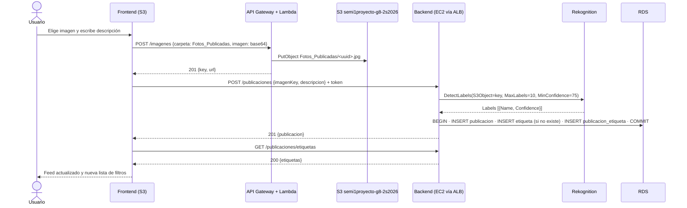

# Publicaciones — feed, etiquetas y filtros

> **Responsable:** R2 · Valery Alarcón (202300794)  
> **Rúbrica:** 2.2 Rekognition, etiquetas (3 de 6) · 2.8 Publicación de imágenes (3) · 2.10 Filtro por etiquetas (3)  
> **Fase:** Fase 1  
> Volver al [manual técnico](../../README.md) · [Plan del equipo](../../docs/plan/distribucion-equipo.md)

## 1. Qué resuelve

- Crear publicación: imagen obligatoria y descripción opcional.
- Al publicar, `DetectLabels` sobre la imagen en S3. Las etiquetas se guardan en RDS.
- Feed con publicaciones propias y de amigos, de la más reciente a la más antigua.
- Filtros dinámicos a partir de las etiquetas, con *Todos* siempre visible y un buscador de etiquetas por texto.

## 2. Servicios de AWS

| Servicio | Recurso | Para qué |
|---|---|---|
| Rekognition | `DetectLabels` | Etiquetas de cada imagen |
| S3 (vía [imágenes](../imagenes/README.md)) | `Fotos_Publicadas/` | Imagen de la publicación |
| RDS | `publicacion`, `etiqueta`, `publicacion_etiqueta` | Publicaciones y etiquetas |

## 3. Contrato de API

Node.js y Python deben responder **exactamente igual**: mismas rutas, mismos códigos HTTP y el
mismo JSON. Cualquier cambio se acuerda aquí antes de programarlo.

Todas las rutas exigen el token de Cognito (`Authorization: Bearer <token>`). El middleware de
[identidad](../identidad/README.md) lo valida y deja el `id` del usuario de RDS en
`request.usuario.id` (Node) o `g.usuario["id"]` (Python). Este módulo nunca recibe el id del
usuario en el cuerpo ni en la ruta: siempre sale del token.

| Método | Ruta | Cuerpo / query | Respuesta |
|---|---|---|---|
| POST | `/publicaciones` | `{"imagenKey":"Fotos_Publicadas/<uuid>.jpg","descripcion":"opcional"}` | `201 {"publicacion": Publicacion}` |
| GET | `/publicaciones` | `?etiqueta=Dog` opcional (sin ella es el filtro *Todos*) | `200 {"publicaciones": [Publicacion]}` |
| GET | `/publicaciones/etiquetas` | `?buscar=do` opcional | `200 {"etiquetas": [{"nombre":"Dog","total":3}]}` |
| GET | `/publicaciones/:id` | — | `200 {"publicacion": Publicacion}` |

Forma de `Publicacion`:

```json
{
  "id": 5,
  "descripcion": "Estudiando para Seminario",
  "imagenUrl": "https://semi1proyecto-g8-2s2026.s3.amazonaws.com/Fotos_Publicadas/<uuid>.jpg",
  "fechaPublicacion": "2026-10-21T08:00:00Z",
  "autor": { "id": 1, "nombreCompleto": "Valery Alarcón", "fotoPerfilUrl": "https://..." },
  "etiquetas": [ { "nombre": "Computer", "confianza": 96 }, { "nombre": "Book", "confianza": 90.25 } ],
  "totalComentarios": 1
}
```

Reglas:

- **Crear:** primero el frontend sube la imagen a API Gateway con `carpeta: "Fotos_Publicadas"`
  (ver [imágenes](../imagenes/README.md)) y manda aquí la `key` que le devolvió. El backend arma la
  URL pública a partir de la key, así nadie puede guardar una URL que no sea del bucket.
  `descripcion` vacía o solo espacios se guarda como `null`; máximo 1000 caracteres.
- **Feed:** publicaciones propias y de amigos (solicitudes `ACEPTADA`), de la más reciente a la más
  antigua; en empate de fecha, la de `id` mayor primero. `etiquetas` va ordenada por confianza
  descendente.
- **Filtro:** `etiqueta` compara el nombre completo, sin distinguir mayúsculas.
- **Etiquetas:** solo las que aparecen en el feed del usuario, ordenadas por `total` descendente y
  luego por nombre. `buscar` filtra por texto contenido en el nombre. *Todos* no es una etiqueta:
  lo agrega el frontend.
- **Ver una:** si no existe o no es del usuario ni de un amigo responde 404 (no se revela que existe).
- **Fechas** en UTC con el formato `AAAA-MM-DDTHH:MM:SSZ`, generado en SQL con `CONCAT(DATE(x), 'T', TIME(x), 'Z')` para
  que los dos backends lo devuelvan idéntico.
- **Etiquetas en inglés**, tal como las devuelve Rekognition.

| Código | Cuándo | Cuerpo |
|---|---|---|
| 400 | Cuerpo no es JSON, `imagenKey` no es `Fotos_Publicadas/<archivo>.jpg\|.jpeg\|.png`, `descripcion` pasa de 1000, `id` no es entero positivo, o Rekognition dice que la imagen no existe o no es válida | `{"error":"..."}` |
| 401 | Sin token o token inválido (lo responde el middleware de identidad) | `{"error":"..."}` |
| 404 | La publicación no existe o no es visible para el usuario | `{"error":"Publicación no encontrada"}` |
| 502 | Rekognition falló por otra causa. **No se crea** la publicación | `{"error":"No se pudieron obtener las etiquetas de la imagen"}` |

## 4. Datos en RDS

| Tabla | Uso |
|---|---|
| `publicacion` | Una fila por publicación, con `imagen_url` (la que ve el frontend) e `imagen_key` (la que recibe Rekognition) |
| `etiqueta` | Catálogo: cada nombre una sola vez (`UNIQUE`) |
| `publicacion_etiqueta` | Qué etiquetas tiene cada publicación y con qué `confianza` |
| `amistad` (vista) | Lee las solicitudes `ACEPTADA` en las dos direcciones para armar el feed |
| `comentario` | Solo para contar `totalComentarios` |

La publicación y sus etiquetas se insertan en **una sola transacción**: o queda todo o no queda nada.

## 5. Flujo



## 6. Dónde está el código

| Pieza | Carpeta |
|---|---|
| Backend Node.js (EC2 No.1) | [`backend-node/src/publicaciones/`](../../backend-node/src/publicaciones/) |
| Backend Python (EC2 No.2) | [`backend-python/src/publicaciones/`](../../backend-python/src/publicaciones/) |
| Frontend React | [`frontend/src/publicaciones/`](../../frontend/src/publicaciones/) |
| Cliente de Rekognition | [`backend-node/src/infrastructure/aws/rekognition.js`](../../backend-node/src/infrastructure/aws/rekognition.js), [`backend-python/src/infrastructure/aws/rekognition.py`](../../backend-python/src/infrastructure/aws/rekognition.py) |
| Pruebas (los mismos casos en los dos lenguajes) | [`backend-node/tests/publicaciones.test.js`](../../backend-node/tests/publicaciones.test.js), [`backend-python/tests/test_publicaciones.py`](../../backend-python/tests/test_publicaciones.py) |

Cada backend sigue la convención de la Práctica 1 (`routes`, `controller`, `service`,
`repository`, `schemas`) y recibe sus dependencias al construirse. Para montarlo en la app:

```js
// backend-node — después del middleware que valida el token de Cognito
import { createPublicacionesRouter } from './publicaciones/publicaciones.routes.js'
import { PublicacionesRepository } from './publicaciones/publicaciones.repository.js'
import { PublicacionesService } from './publicaciones/publicaciones.service.js'
import { createEtiquetador } from './infrastructure/aws/rekognition.js'

const publicaciones = new PublicacionesService({
  repository: new PublicacionesRepository(pool),          // pool de mysql2/promise
  etiquetador: createEtiquetador({ region: 'us-east-1', bucket: 'semi1proyecto-g8-2s2026' }),
  s3PublicUrl: 'https://semi1proyecto-g8-2s2026.s3.amazonaws.com',
})
app.use('/publicaciones', requireAuth, createPublicacionesRouter(publicaciones))
```

```python
# backend-python — después del before_request que valida el token y llena g.usuario
from src.infrastructure.aws.rekognition import Etiquetador
from src.publicaciones.repository import PublicacionesRepository
from src.publicaciones.routes import create_publicaciones_blueprint
from src.publicaciones.service import PublicacionesService

publicaciones = PublicacionesService(
    repository=PublicacionesRepository(pool.get_connection),  # MySQLConnectionPool
    etiquetador=Etiquetador(region="us-east-1", bucket="semi1proyecto-g8-2s2026"),
    s3_public_url="https://semi1proyecto-g8-2s2026.s3.amazonaws.com",
)
app.register_blueprint(create_publicaciones_blueprint(publicaciones))
```

```tsx
// frontend — en la ruta de la página principal
import { createPublicacionesApi, PublicacionesPage } from '../publicaciones'

const api = createPublicacionesApi({ request, apiUrl: ALB_URL, imagenesApiUrl: IMAGENES_API_URL })
<PublicacionesPage api={api} renderExtras={(p) => <Comentarios publicacion={p} />} />
```

`renderExtras` es el espacio debajo de cada publicación para comentarios y traducción.

Pruebas (con el MySQL local levantado):

```bash
cd Proyecto/backend-node && npm install && npm test
cd Proyecto/backend-python && python -m venv venv && venv/Scripts/pip install -r requirements.txt && venv/Scripts/python -m pytest tests
```

## 7. Configuración en AWS

Rekognition no necesita crear ningún recurso: `DetectLabels` es una API que se llama sobre una imagen
que ya está en S3. Lo que sí hace falta:

| Qué | Dónde | Detalle |
|---|---|---|
| Permiso `rekognition:DetectLabels` y `s3:GetObject` sobre `Fotos_Publicadas/*` | `proyecto-rekognition-policy-g8` ([plataforma](../plataforma/README.md)) | Rekognition lee la imagen con las credenciales de quien lo llama. Va en el rol `proyecto-ec2-role-g8` (EC2) y en el usuario `proyecto-iam-rekognition-g8` (local) |
| Misma región que el bucket | `us-east-1` | `DetectLabels` con `S3Object` exige que el bucket esté en la región del cliente |
| `MaxLabels = 10`, `MinConfidence = 75` | Código (`createEtiquetador` / `Etiquetador`) | 10 etiquetas bastan para filtrar sin llenar la lista de ruido; por debajo de 75 % aparecen etiquetas que no corresponden a la imagen |
| Formato JPEG o PNG, máximo 5 MB desde S3 | Lambda de [imágenes](../imagenes/README.md) y `imagen.ts` | La Lambda ya limita a 4 MB y el frontend comprime a JPEG de 1920 px |

Variables de entorno de los backends para este dominio: `AWS_REGION=us-east-1`,
`S3_BUCKET=semi1proyecto-g8-2s2026` y `S3_PUBLIC_URL=https://semi1proyecto-g8-2s2026.s3.amazonaws.com`.

## 8. Evidencias

Guardar cada captura en [`img/`](img/) con el nombre indicado y enlazarla en esta tabla.

| Archivo | Dónde se toma | Qué debe verse |
|---|---|---|
| `feed.png` | Aplicación | Feed con publicaciones propias y de amigos en orden |
| `filtros.png` | Aplicación | Lista de filtros, *Todos* y el buscador funcionando |
| `etiquetas-rds.png` | Cliente MySQL | Etiquetas guardadas de una publicación |

## 9. Preguntas que todo el grupo debe poder responder

1. **¿Qué parámetros recibe `DetectLabels` (`MinConfidence`, `MaxLabels`) y qué valores usamos?**

   Recibe la imagen, que en nuestro caso es una referencia al objeto en S3
   (`Image.S3Object = { Bucket: "semi1proyecto-g8-2s2026", Name: <imagen_key> }`). La imagen no viaja
   por el backend: Rekognition la lee directo de S3. `MaxLabels` es el máximo de etiquetas que
   devuelve y `MinConfidence` es el porcentaje mínimo de confianza para incluir una. Usamos
   **`MaxLabels = 10`** y **`MinConfidence = 75`**: 10 etiquetas bastan para filtrar sin llenar la
   lista de ruido, y por debajo de 75 % empiezan a salir etiquetas que no corresponden a la imagen.
   De cada etiqueta guardamos `Name` y `Confidence`.

2. **¿Cómo se arma la consulta del feed con las amistades aceptadas?**

   Se piden las publicaciones cuyo autor es el usuario **o** uno de sus amigos, de la más reciente
   a la más antigua:

   ```sql
   SELECT ... FROM publicacion p
   WHERE p.usuario_id = :yo
      OR p.usuario_id IN (SELECT amigo_id FROM amistad WHERE usuario_id = :yo)
   ORDER BY p.fecha_publicacion DESC, p.id DESC;
   ```

   `amistad` es una vista sobre `solicitud_amistad` con estado `ACEPTADA`, en las dos direcciones,
   así que no importa quién envió la solicitud. Para filtrar por etiqueta se agrega un
   `EXISTS` sobre `publicacion_etiqueta` unida con `etiqueta`.

3. **¿Por qué hay una tabla intermedia `publicacion_etiqueta`?**

   Porque la relación es **muchos a muchos**: una publicación tiene varias etiquetas y una etiqueta
   aparece en muchas publicaciones. Una columna en `publicacion` no puede guardar varias etiquetas,
   y repetir el nombre en cada fila duplicaría datos y haría que la lista de filtros saliera con
   repetidos. La tabla intermedia guarda cada par (publicación, etiqueta) una sola vez (llave
   primaria compuesta) y además la **`confianza`**, que es un dato de la relación: la misma etiqueta
   puede tener 99 % en una foto y 80 % en otra.
