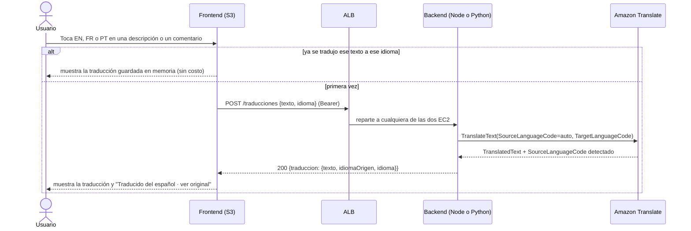

# Traducción — Amazon Translate

> **Responsable:** R5 · Fátima Cerezo (202300434)  
> **Rúbrica:** 2.5 Translate (4)  
> **Fase:** Fase 1  
> Volver al [manual técnico](../../README.md) · [Plan del equipo](../../docs/plan/distribucion-equipo.md)

## 1. Qué resuelve

- Traducir la descripción de una publicación y sus comentarios a inglés (`en`), francés (`fr`) y portugués (`pt`), además del español.
- Detección automática del idioma de origen.

## 2. Servicios de AWS

| Servicio | Recurso | Para qué |
|---|---|---|
| Translate | `TranslateText` | Traducción bajo demanda |

## 3. Contrato de API

Node.js y Python deben responder **exactamente igual**: mismas rutas, mismos códigos HTTP y el
mismo JSON. Cualquier cambio se acuerda aquí antes de programarlo.

Exige el token (`Authorization: Bearer <token>`), para que solo usuarios de la app generen cobros.

| Método | Ruta | Cuerpo | Respuesta |
|---|---|---|---|
| POST | `/traducciones` | `{"texto":"...","idioma":"en"\|"fr"\|"pt"}` | `200 {"traduccion": {"texto":"...","idiomaOrigen":"es","idioma":"en"}}` |

Reglas:

- **Idioma de origen automático:** `TranslateText` con `SourceLanguageCode="auto"`. El que detecta
  Translate vuelve en `idiomaOrigen`.
- **Destinos:** solo `en`, `fr` y `pt` (decisión 9 del plan); el español es el original.
- `texto` se recorta y debe tener de 1 a 5000 caracteres.
- **No guarda nada en RDS.** El frontend cachea cada `(texto, idioma)` durante la sesión, así la
  misma traducción no se paga dos veces.
- Sirve igual para descripciones y comentarios: recibe texto, no ids.

| Código | Cuándo | Cuerpo |
|---|---|---|
| 400 | Cuerpo no es JSON, `texto` vacío o de más de 5000, o `idioma` no es `en`, `fr` ni `pt` | `{"error":"..."}` |
| 401 | Sin token o token inválido | `{"error":"..."}` |
| 502 | Translate falló | `{"error":"No se pudo traducir el texto"}` |

## 4. Datos en RDS

No usa tablas propias.

## 5. Flujo

## 6. Dónde está el código

| Pieza | Carpeta |
|---|---|
| Backend Node.js (EC2 No.1) | [`backend-node/src/traduccion/`](../../backend-node/src/traduccion/) |
| Backend Python (EC2 No.2) | [`backend-python/src/traduccion/`](../../backend-python/src/traduccion/) |
| Frontend React | [`frontend/src/traduccion/`](../../frontend/src/traduccion/) |

El cliente de AWS está en `src/infrastructure/aws/translate.js` y `translate.py`. Pruebas:
`backend-node/tests/traduccion.test.js` y `backend-python/tests/test_traduccion.py`, con Translate
simulado.

## 7. Configuración en AWS

Translate no se aprovisiona: es un servicio administrado que se cobra por carácter traducido. Lo
único que se configura son los permisos.

| Quién llama | Credenciales | Permiso |
|---|---|---|
| Backends en las EC2 | Rol `proyecto-ec2-role-g8` (sin llaves) | [`proyecto-translate-policy-g8`](../../infra/iam/politicas/proyecto-translate-policy-g8.json) |
| Backends en local | Usuario `proyecto-iam-translate-g8` (`TRANSLATE_ACCESS_KEY_ID` y `TRANSLATE_SECRET_ACCESS_KEY`) | La misma política |

La política permite `translate:TranslateText` y `comprehend:DetectDominantLanguage`: con
`SourceLanguageCode="auto"`, Translate usa Comprehend por dentro para detectar el idioma de origen,
y sin ese permiso la llamada falla.

Los clientes eligen las credenciales con `credencialesDe('TRANSLATE')` (`credenciales_de` en
Python): si existen las variables de la llave las usan; si no, el SDK toma el rol de la EC2.

## 8. Evidencias

Guardar cada captura en [`img/`](img/) con el nombre indicado y enlazarla en esta tabla.

| Archivo | Dónde se toma | Qué debe verse |
|---|---|---|
| `traduccion-app.png` | Aplicación | Una descripción y un comentario traducidos |
| `traduccion-iam.png` | IAM → política | El permiso `translate:TranslateText` |

## 9. Preguntas que todo el grupo debe poder responder

1. ¿Cómo detecta Translate el idioma de origen? (`SourceLanguageCode=auto`)
2. ¿Cómo cobra Translate y cómo evitamos traducir lo mismo dos veces?
